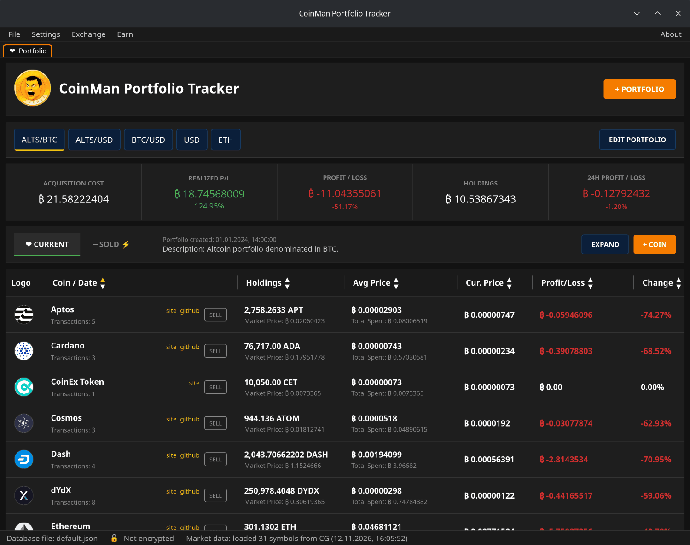

# What is CoinMan

CoinMan Portfolio Tracker is a desktop program for keeping a record of your
cryptocurrency purchases and sales and seeing what they are worth now. It also
has built-in exchanges (swaps and bridges between networks), a token approval
manager and Yearn Finance vaults.

## The essentials

- **Portfolios.** Any number of portfolios in one database file, each in its
  own currency: USD, BTC, ETH and so on. For every coin: holdings, average
  buy price, current price, profit or loss and its change in percent.
- **Purchases and sales.** Each purchase is a transaction with a price,
  amount, date, wallet and notes. A sale takes coins from the oldest
  purchases first and moves them to the **Sold** view with the realized
  profit.
- **Prices** come from CoinGecko (no key needed) or CoinMarketCap (your own
  API key).
- **Local storage.** Portfolios are kept in JSON files on your computer. No
  account, e-mail or phone number. A database can be encrypted with a
  password (AES-256-GCM, Argon2id).
- **Exchange.** Best Rate compares 15 services and finds the best route;
  Li-Fi, CoW Swap and Jumper are also available as full exchange widgets.
- **Approvals** shows which contracts may spend your tokens and lets you
  revoke them.
- **Earn** — Yearn Finance vaults: browse, compare, deposit and withdraw.
- **Window tabs** keep several modules open at once.

## What goes online

The portfolio itself works offline. The program contacts the internet for:

- prices (CoinGecko or CoinMarketCap);
- the update check (GitHub, once a week);
- Exchange, Approvals and Earn: route services, blockchain nodes,
  WalletConnect relays, Yearn and the exchanges' own websites.

These services see your wallet addresses and what you ask them for;
transactions on blockchains are public. Keys never leave your wallet: CoinMan
asks the wallet to sign and checks every transaction before that.

## What it does not do

- It does not hold your coins or keys and cannot move coins without your
  confirmation in the wallet.
- It does not read balances from exchanges or wallets into the portfolio:
  portfolio transactions are entered by hand.
- It is not financial advice. Check amounts, addresses and fees before you
  sign.

## License

CoinMan Portfolio Tracker is open source under the MIT license.
Source code: [github.com/coinman-dev/portfolio](https://github.com/coinman-dev/portfolio).
