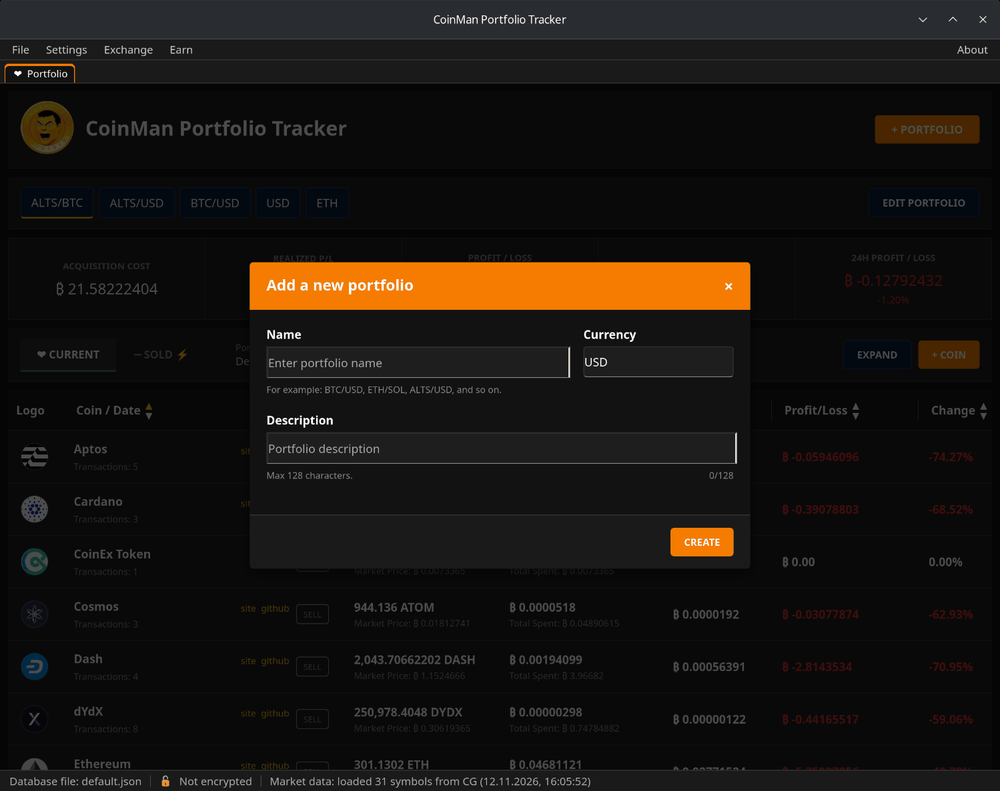
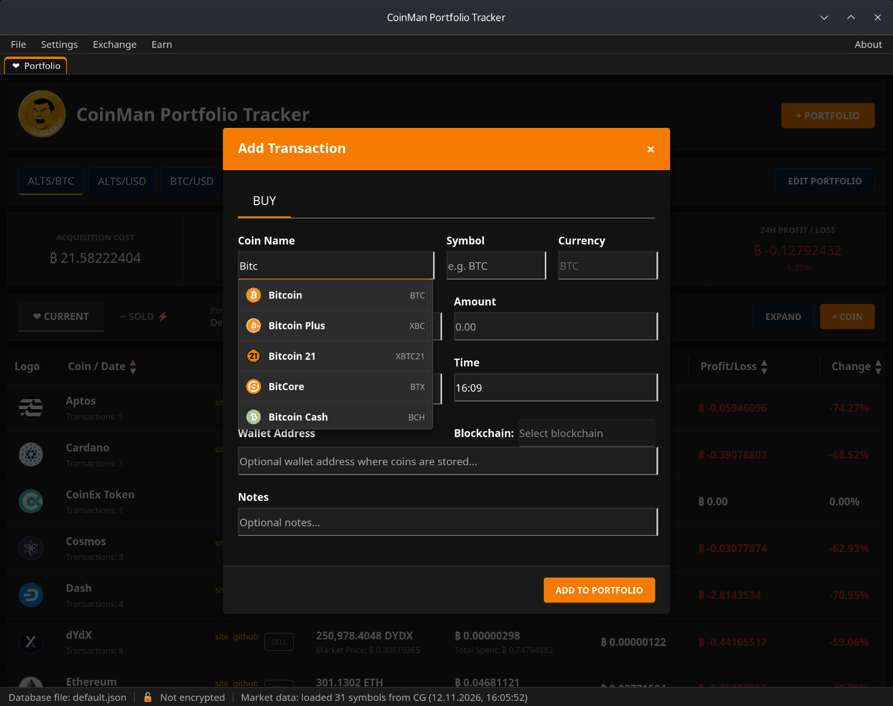

# Quick start

## 1. Start the program

On the first start the program creates the database `data/base/default.json`
next to itself with one portfolio and opens the main window. The name of the
open database is shown on the left of the status bar.

## 2. Create a portfolio

Click **+ PORTFOLIO**.

- **Name** — anything, for example `ALTS/BTC` or `Long-term`.
- **Currency** — what the portfolio is counted in: `USD`, `BTC`, `ETH` and so
  on. Prices, costs and profit are shown in this currency.
- **Description** — optional, up to 128 characters.

Click **CREATE**. The new portfolio appears as a button under the header;
click a button to switch to that portfolio.

## 3. Add a purchase

Click **+ COIN**.

1. Start typing the coin name in **Coin Name** and choose the coin from the
   list — the symbol and the logo are filled in from the catalog.
2. **Buy Price** — the price of one coin in the portfolio currency.
3. **Amount** — how many coins you bought.
4. **Date** and **Time** — when you bought them.
5. Optionally: the wallet address and blockchain where the coins are kept,
   and notes.

Click **ADD TO PORTFOLIO**. The coin appears in the table with its current
price and profit.

## 4. What next

- [Portfolios and transactions](04-portfolios-and-transactions.md) — selling,
  editing, the Sold view and what the figures mean.
- [Database files and encryption](05-databases-and-encryption.md) — protect
  the database with a password.
- [Best Rate](09-best-rate.md) — find where to exchange coins at the best
  rate.
