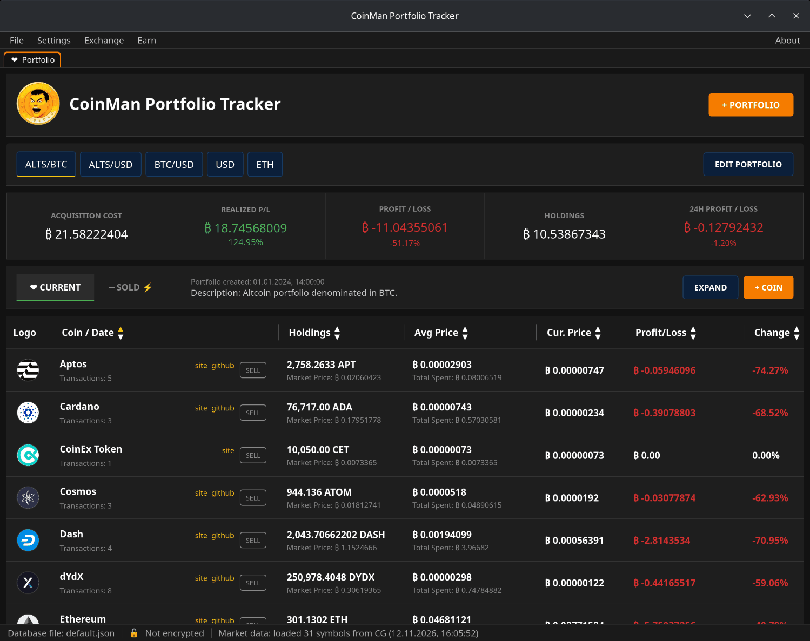
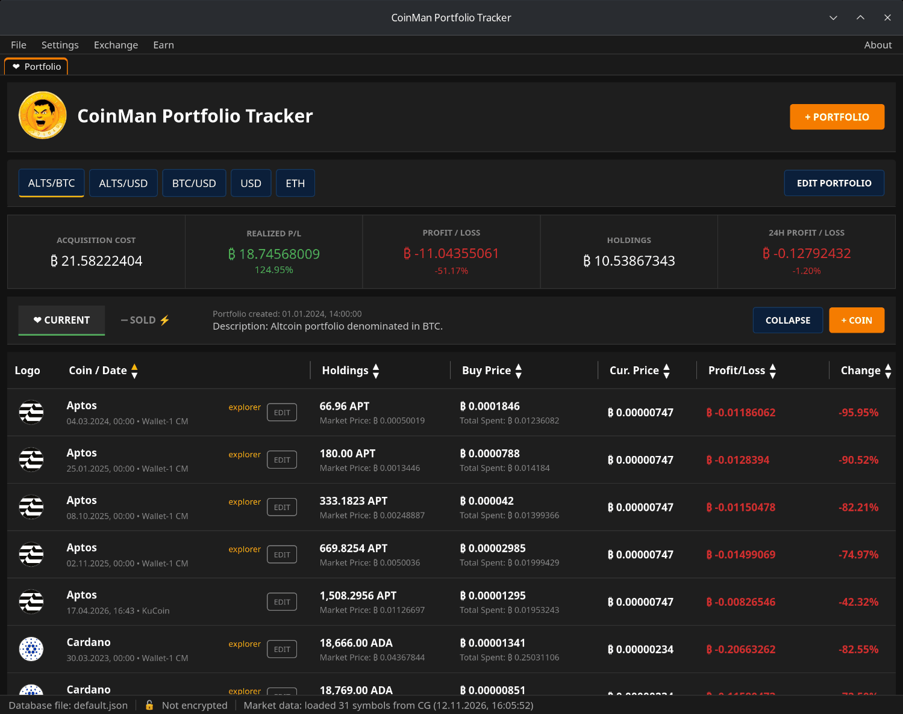
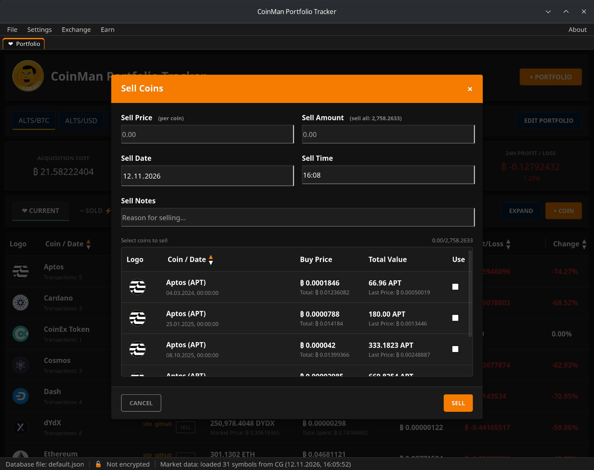
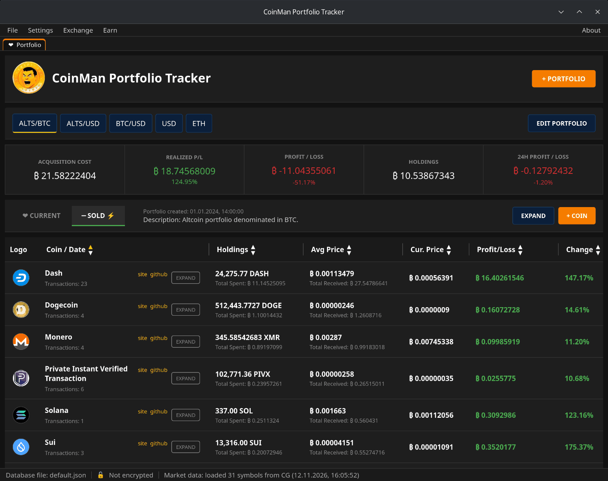
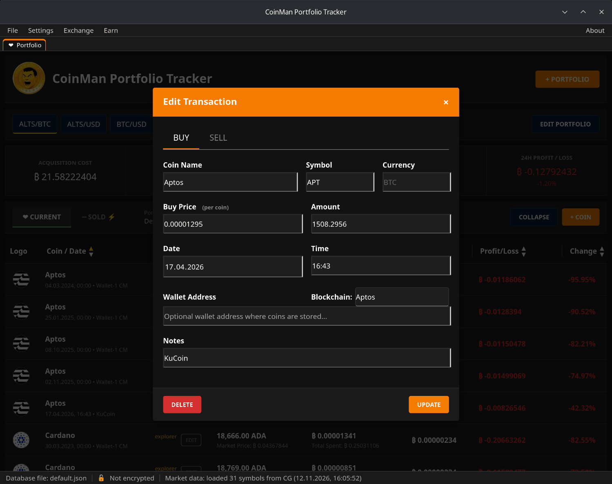
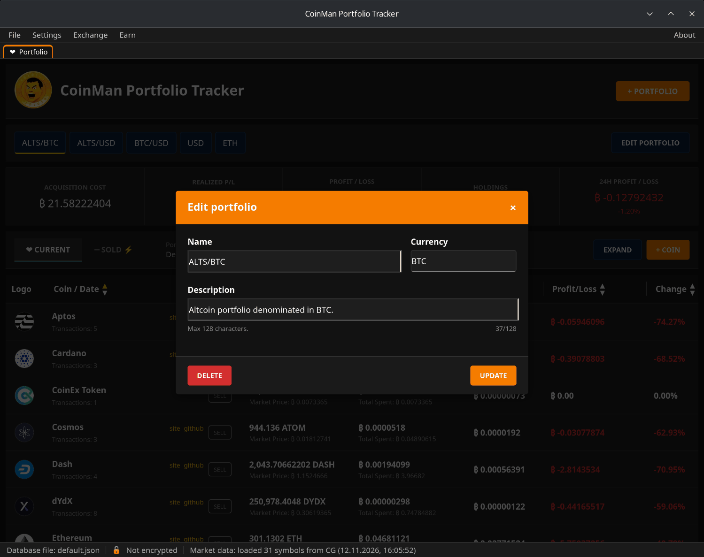

# Portfolios and transactions

From top to bottom:

- **Menu** — File, Settings, Exchange, Earn, About.
- **Window tabs** — Portfolio and the modules you opened (see
  [Window tabs](07-window-tabs.md)).
- **+ PORTFOLIO** — create a portfolio.
- **Portfolio buttons** (`ALTS/BTC`, `USD`…) — switch between portfolios.
  Drag a button left or right to change the order. **EDIT PORTFOLIO** —
  rename, change the description or delete the portfolio.
- **Figures** of the selected portfolio (see below).
- **CURRENT / SOLD** — coins you hold and coins you sold.
- **EXPAND / COLLAPSE** — one row per coin or one row per transaction.
- **+ COIN** — add a purchase.
- **The table** and, at the bottom, the **status bar**.

## The figures

| Figure | What it is |
|---|---|
| Acquisition cost | What the coins you hold cost: amount × buy price, summed. |
| Realized P/L | Profit from sales: (sell price − buy price) × amount, summed over the Sold view; below, in percent of what the sold coins cost. |
| Profit / Loss | Unrealized profit: holdings at the current price minus the acquisition cost, and in percent. |
| Holdings | What the coins you hold are worth at the current prices. |
| 24h Profit / Loss | How much the holdings changed in the last 24 hours. |

Everything is in the portfolio currency. A coin without a current price is
counted at its buy price.

## The table

In the collapsed view (the default) each coin takes one row:

- **Coin / Date** — the coin, the number of transactions and links to the
  project's **site**, **github** or the **explorer** of the wallet address.
- **Holdings** — the total amount and its market value.
- **Avg Price** — the average buy price and the total spent.
- **Cur. Price** — the current price (can be hidden in Settings).
- **Profit/Loss** and **Change** — in the portfolio currency and in percent.

Click a column header to sort by it; click again to reverse the order. Drag
the border between headers to change a column's width — the widths are
remembered.

**EXPAND** shows every purchase in its own row with the date, the wallet and
notes, and an **EDIT** button.

## Selling

In the collapsed view click **SELL** in the coin's row.

1. **Sell Price** — the price of one coin in the portfolio currency.
2. **Sell Amount** — how many coins you sold. The hint shows how many you
   hold ("sell all").
3. **Sell Date**, **Sell Time** and, optionally, **Sell Notes**.

The list below shows which purchases the sale is taken from: the oldest
first (FIFO). The checkboxes follow the amount you type. If the amount covers
only part of a purchase, that purchase is split: the sold part goes to the
Sold view, the rest stays in Current.

Click **SELL**. Selling more than you hold is refused.

## The Sold view

**SOLD** shows the coins you sold with the buy and sell prices, the total
received and the realized profit. In the collapsed view the row button is
**EXPAND** — it opens the sales one by one.

## Editing and deleting a transaction

Expand the table and click **EDIT** in the transaction's row.

- The **BUY** tab changes the purchase: price, amount, date, wallet, notes.
  **UPDATE** saves, **DELETE** removes the transaction.
- The **SELL** tab sells this one purchase (all of it or part of it).

## Editing and deleting a portfolio

**EDIT PORTFOLIO** opens the name, currency and description of the selected
portfolio. **UPDATE** saves; **DELETE** deletes the portfolio with all its
transactions after a confirmation. The last remaining portfolio cannot be
deleted.

## Entering numbers

Prices and amounts accept both a comma and a period as the decimal
separator, and spaces between digit groups — pasting `1 234,5` or `1,234.5`
works.
