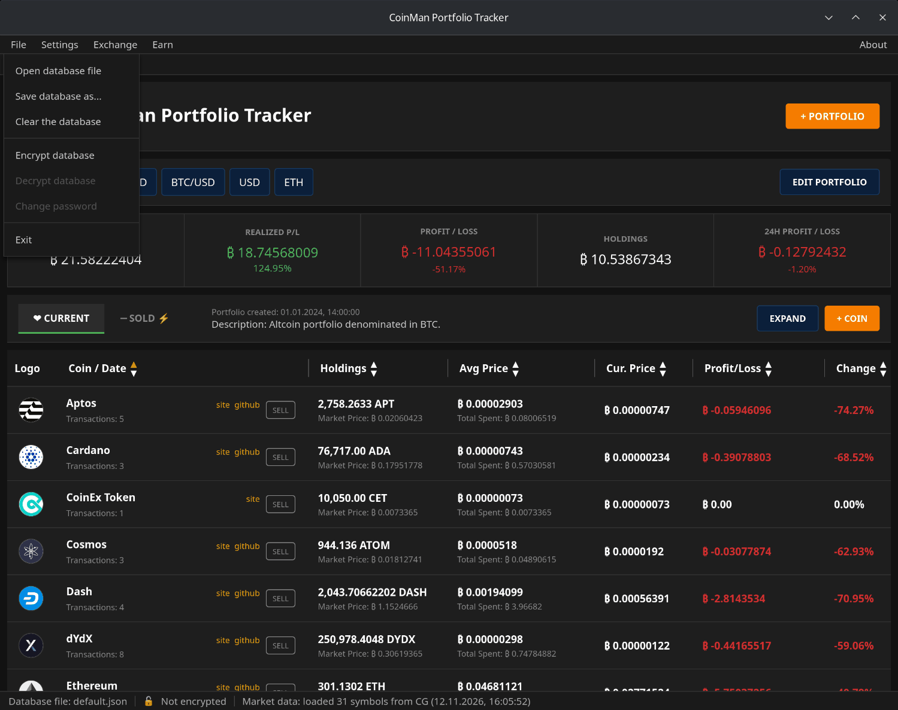
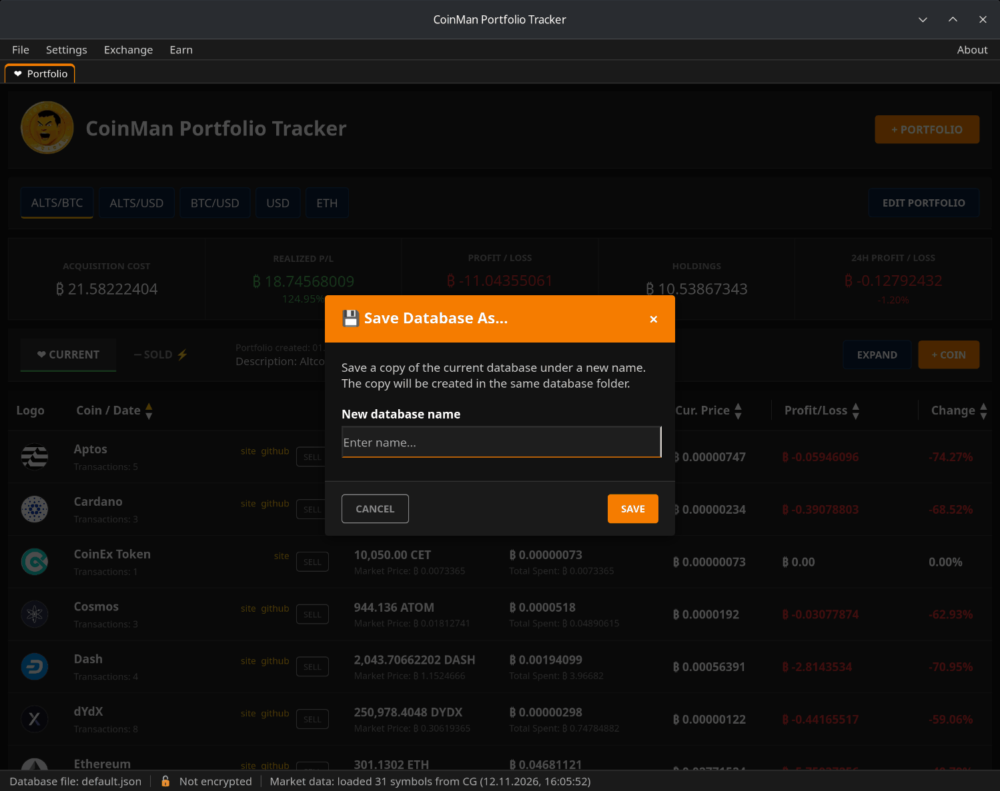
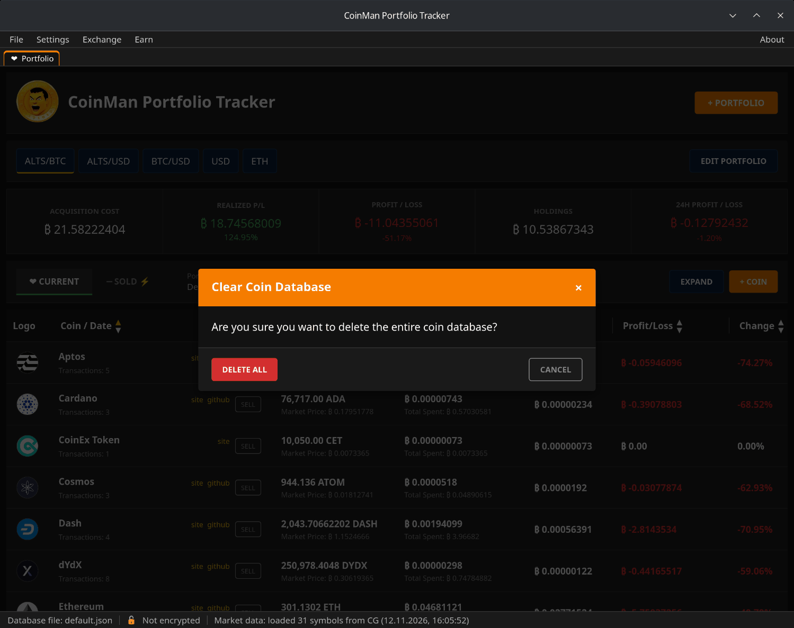
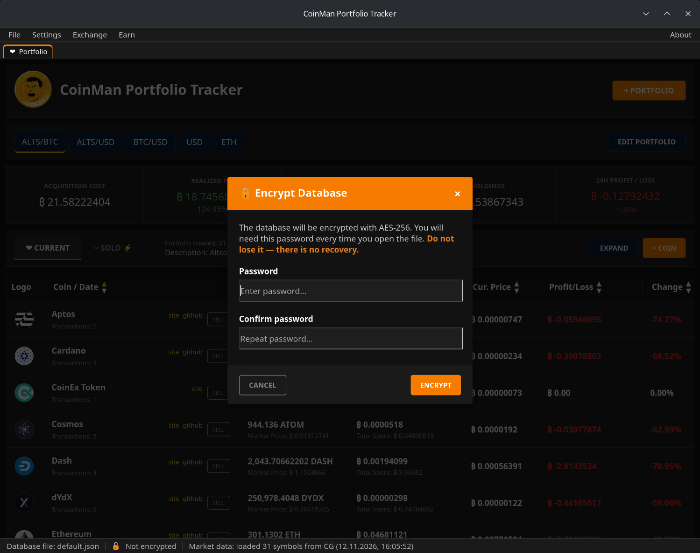
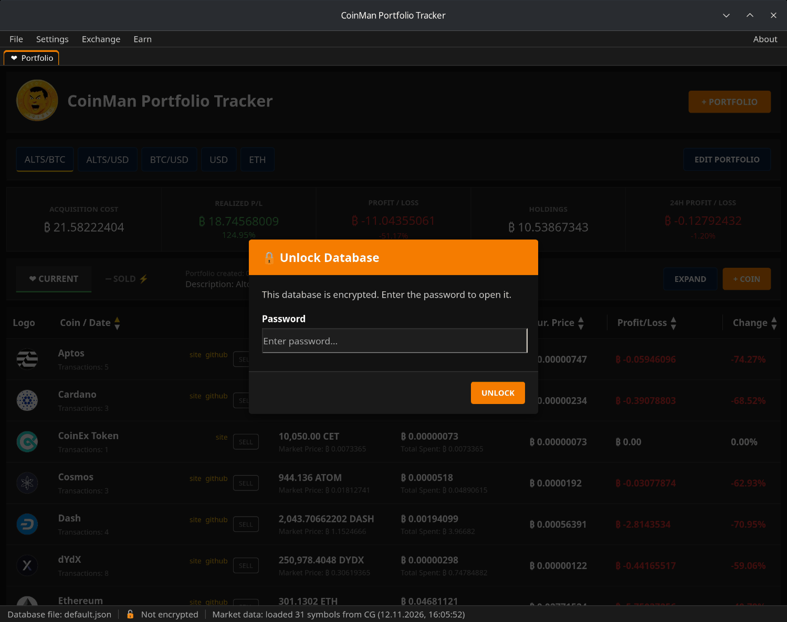

# Database files and encryption

All portfolios are kept in a database — a JSON file in the `data/base` folder
next to the program. The default one is `default.json`. You can keep several
databases (for example, your own and a family one) and switch between them.

## File menu

- **Open database file** — choose a `.json` file in the system dialog. The
  program switches to it; the status bar shows its name.
- **Save database as...** — save a copy of the open database under a new
  name in the same folder.
- **Clear the database** — delete all coins of the database after a
  confirmation (**DELETE ALL**). This cannot be undone, so make a copy first.
- **Encrypt database / Decrypt database / Change password** — see below.
- **Exit** — close the program.

## Encryption

**File → Encrypt database** protects the open database with a password.

Enter the password twice and click **ENCRYPT**. The file stays where it was,
under the same name, but its contents are encrypted. The status bar shows
**Encrypted** instead of **Not encrypted**.

When the program opens an encrypted database — at start or after **Open
database file** — it asks for the password:

- **Change password** — re-encrypts the database with a new password.
- **Decrypt database** — removes the password and stores the database as a
  plain JSON file again.

The password is not saved anywhere; the program keeps it in memory only
while it runs.

> **If you forget the password, the database cannot be recovered.** Keep the
> password safe and keep a backup copy.

### Technical details

| | |
|---|---|
| Cipher | AES-256-GCM |
| Key derivation | Argon2id, 64 MB of memory, 2 iterations, 1 thread |
| Salt | 16 bytes, new for every encryption |
| Nonce | 12 bytes, new for every encryption |

### What is not encrypted

Only the portfolio database is encrypted. Settings, API keys, saved wallets
and WalletConnect sessions, exchange and revoke histories and logs are stored
as they are — see [Files, folders and logs](13-files-and-logs.md). Keep the
program folder private.
