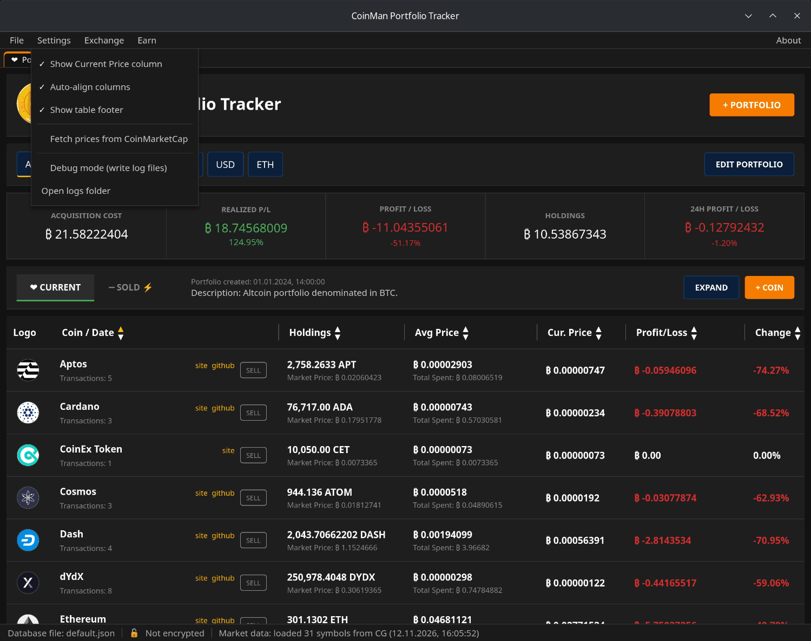
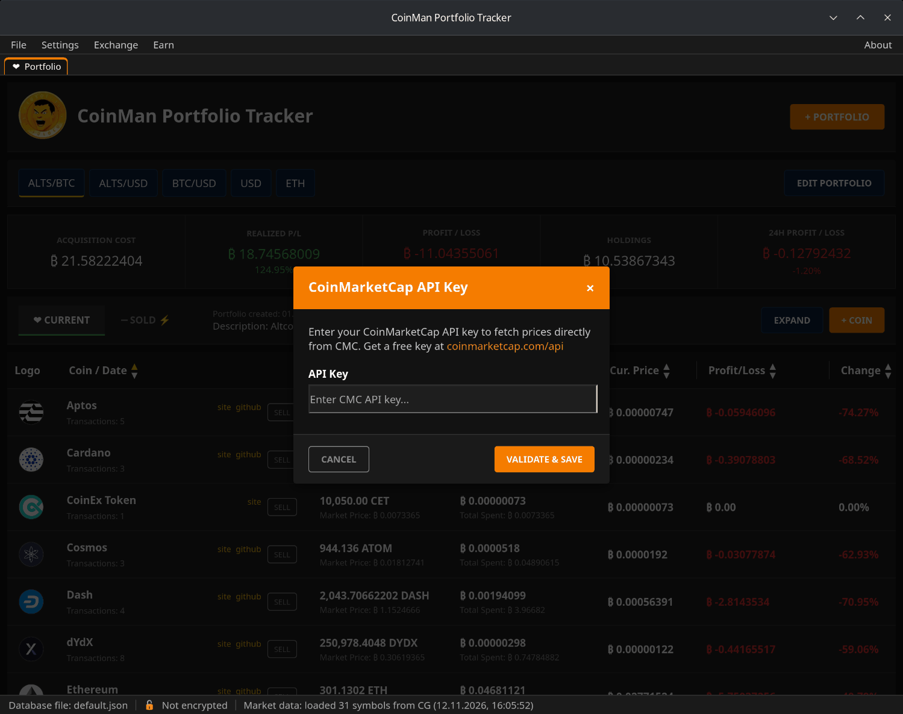
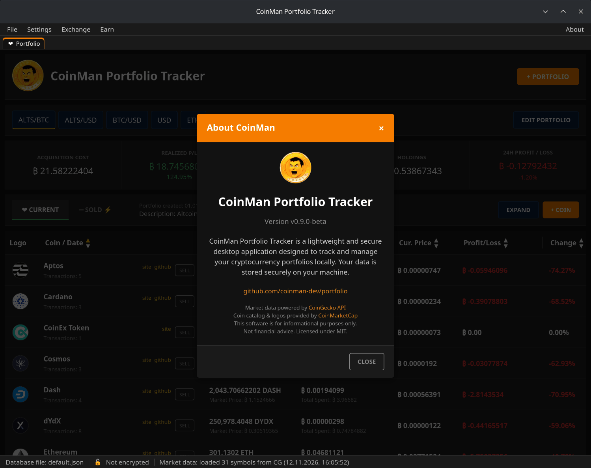

# Settings and prices

A tick in front of an item means it is on. Changes apply at once and are
remembered.

| Item | What it does |
|---|---|
| Show Current Price column | Shows or hides the **Cur. Price** column. |
| Auto-align columns | Fits the column widths to their contents. Turn it off to set the widths by hand by dragging the header borders. |
| Show table footer | A totals row at the bottom of the table. |
| Fetch prices from CoinMarketCap | Takes prices from CoinMarketCap instead of CoinGecko (see below). |
| Debug mode (write log files) | Writes a daily log file to the `Logs` folder. |
| Open logs folder | Opens the `Logs` folder in the file manager. |

## Prices: CoinGecko or CoinMarketCap

By default prices come from **CoinGecko** — no key needed.

To use **CoinMarketCap**:

1. Get a free API key at
   [coinmarketcap.com/api](https://coinmarketcap.com/api/).
2. Choose **Settings → Fetch prices from CoinMarketCap**.
3. Paste the key and click **VALIDATE & SAVE**. The key is checked at once;
   if it works, CoinMarketCap becomes the price source.

If the key stops working, the program falls back to CoinGecko. To go back to
CoinGecko yourself, choose the same menu item again.

## The status bar

- **Database file** — the name of the open database.
- **Encrypted / Not encrypted** — whether it is protected by a password.
- **Market data** — how many coins got a price, from which source (`CG` —
  CoinGecko, `CMC` — CoinMarketCap) and when.
- **Update available** — appears when a new version is out; click it to open
  the release page.

## About

**About → About CoinMan** shows the version, the project link and the data
sources.

