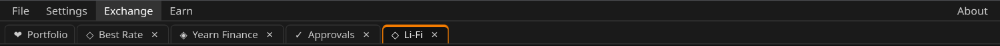

# Window tabs

Under the menu there is a row of tabs, like in a browser.

- **Portfolio** is always there and cannot be closed.
- Every module you open from the **Exchange** or **Earn** menu — Best Rate,
  Li-Fi, CoW Swap, Jumper, Approvals, Yearn Finance — gets its own tab. If
  the tab is already open, the program just switches to it. Links in Best
  Rate that open CoW Swap or Jumper open their tabs too.
- Click a tab to switch to it. Modules stay loaded in the background, so a
  tab keeps its state: a Best Rate quote, an open Yearn vault, the Jumper
  page.
- **×** on a tab, or a click with the middle mouse button, closes it. Closing
  only removes the tab; opening the module again shows it as you left it,
  until the program is restarted.
- Drag a tab left or right to change the order.

The open tabs and their order are remembered between launches. A restored
tab loads its module only when you click it for the first time.

The **← PORTFOLIO** button in a module's header is the same as clicking the
Portfolio tab.
