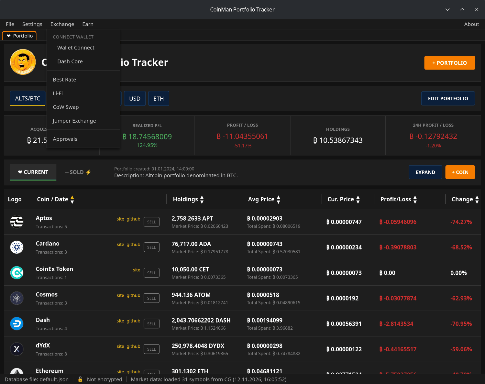
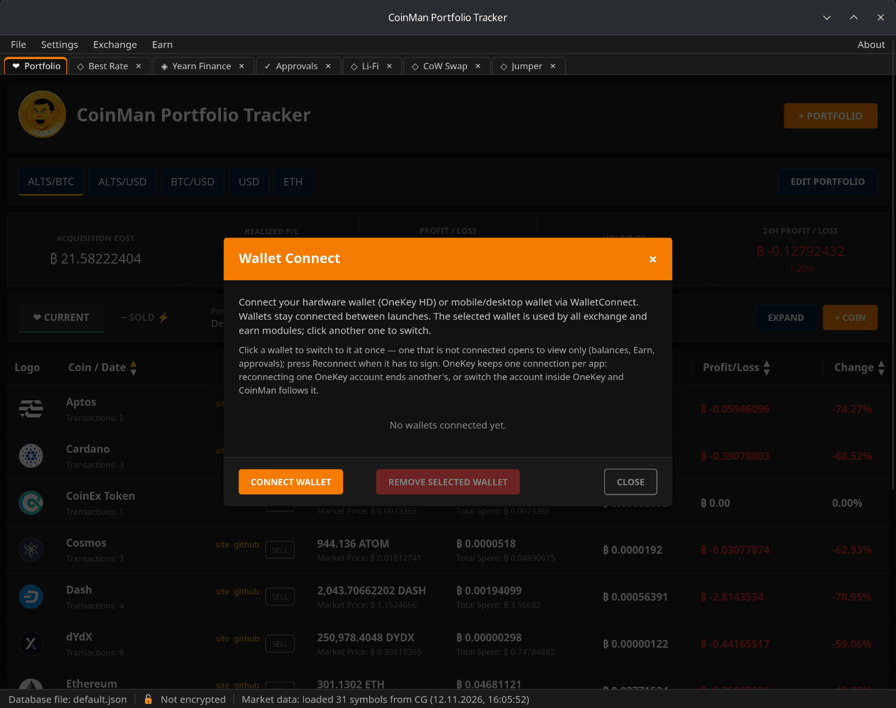
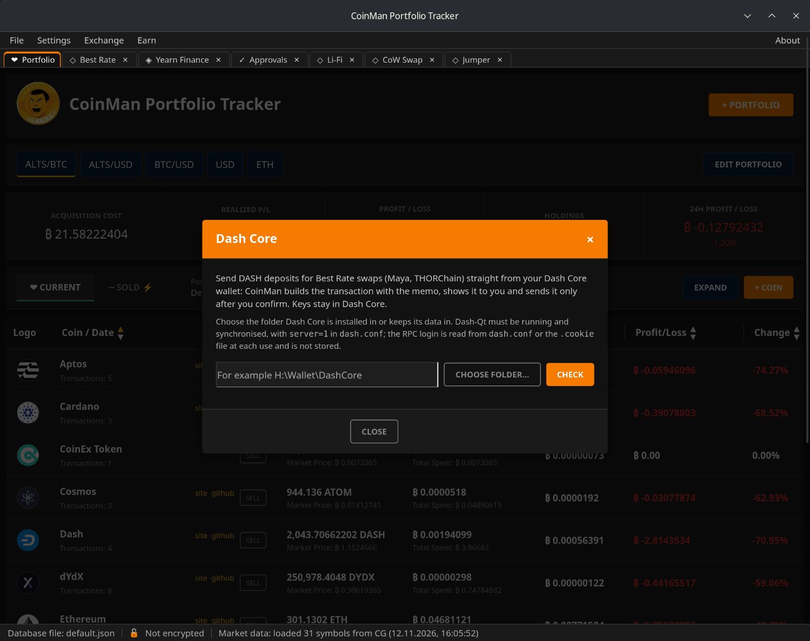

# Wallets

Exchange, Approvals and Earn work with your wallet: they show its balances
and ask it to sign transactions. The keys stay in the wallet; CoinMan only
sends it requests, and you confirm each one in the wallet.

## WalletConnect

**Exchange → Wallet Connect** (or **Earn → Wallet Connect**) connects a
hardware wallet (OneKey) or a mobile or desktop wallet through WalletConnect:
scan the QR code with the wallet and approve the connection.

- Several wallets can be saved. The **selected** wallet is used by all
  Exchange and Earn modules; click another one in the list to switch.
- Wallets stay connected between launches. A tick in the menu shows a
  connected wallet.
- A saved wallet that is not connected opens **to view only**: balances,
  Earn positions and approvals are shown, but it cannot sign. Press
  **Reconnect** in its row when it has to sign.
- **CONNECT ANOTHER WALLET** adds a wallet, **REMOVE SELECTED WALLET** removes
  the selected one and ends its WalletConnect session in the wallet app too.

EVM networks, Tron and Solana use separate connections. OneKey keeps one
connection per application: reconnecting one OneKey account ends another's,
or switch the account inside OneKey and CoinMan follows it.

Supported EVM networks: Ethereum, Arbitrum, Optimism, Polygon, BNB Chain,
Base, Avalanche, Katana, Gnosis, Linea, Sonic, Unichain, zkSync, Scroll,
Mantle and Blast. Each exchange or vault may support fewer.

## Dash Core

**Exchange → Dash Core** connects the Dash Core wallet (Dash-Qt) on your
computer. Then Best Rate can send DASH deposits for Maya Protocol and
THORChain swaps straight from it — see
[Best Rate → Sending from Dash Core](09-best-rate.md#sending-from-dash-core).

1. Start Dash-Qt and wait until it is synchronised. In `dash.conf` there must
   be the line `server=1`.
2. In CoinMan, type the folder Dash Core is installed in or keeps its data
   in, or choose it with **CHOOSE FOLDER...**.
3. Click **CHECK**. The program checks the folder, `dash.conf`, the RPC
   login, that the node answers, is synchronised and has the wallet open, and
   remembers the folder.

The RPC login is read from `dash.conf` or the `.cookie` file at each use and
is not stored. Keys stay in Dash Core.
