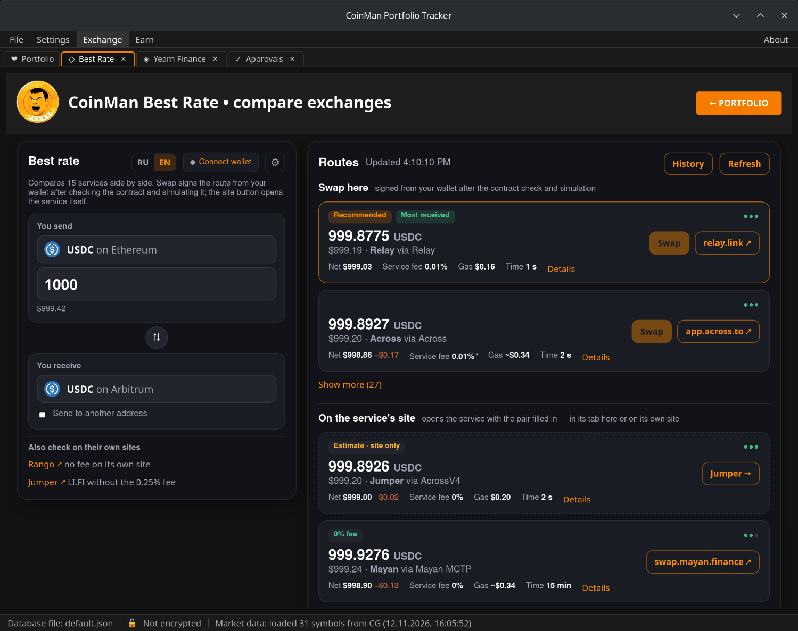
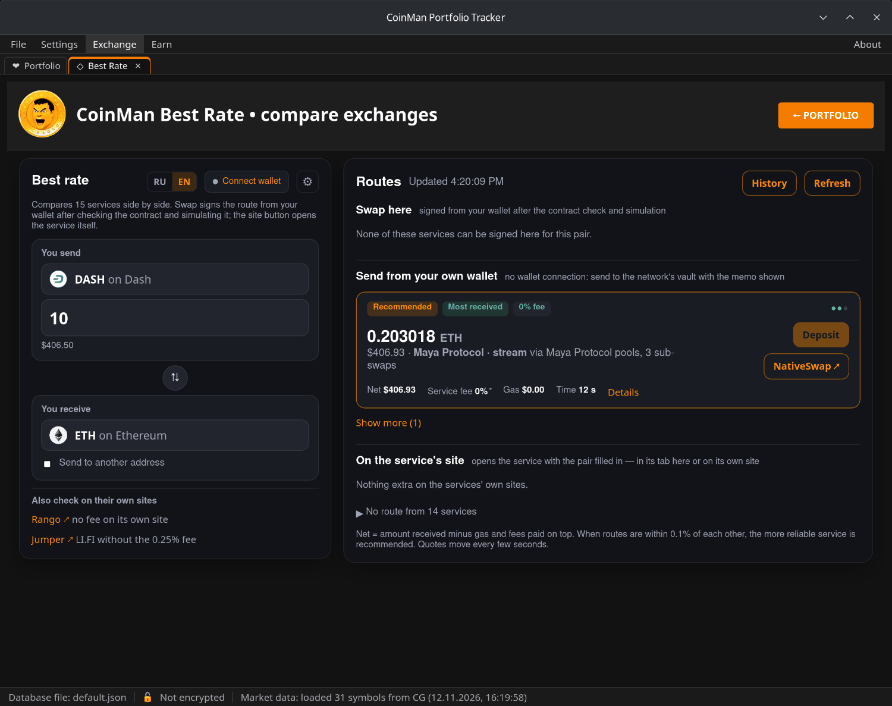
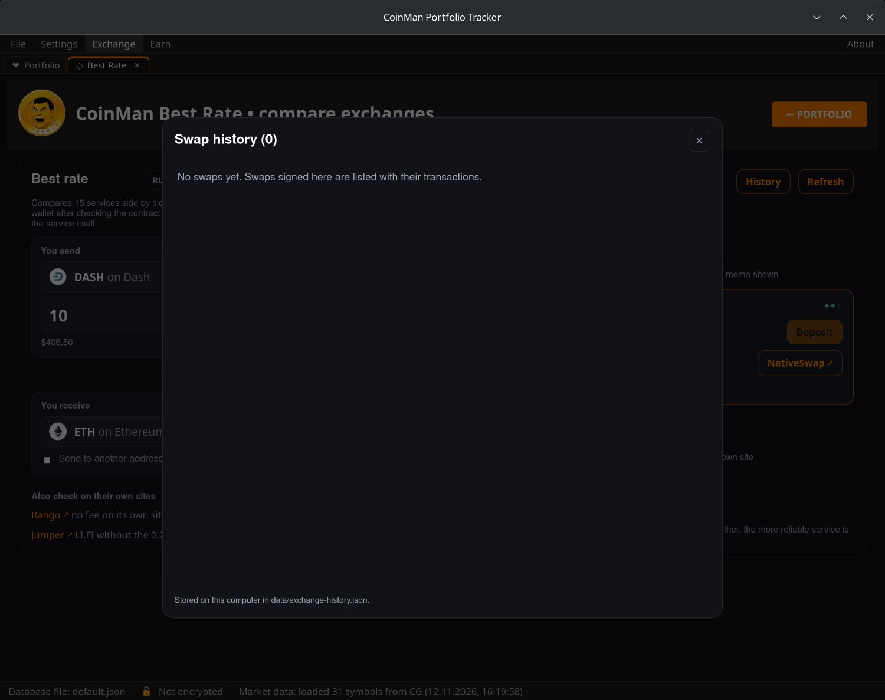
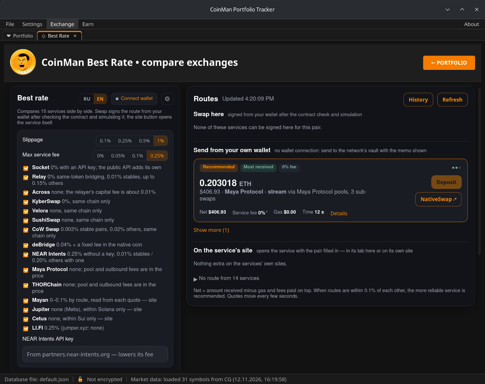

# Best Rate

**Exchange → Best Rate** asks 15 exchange and bridge services at once and
shows their offers side by side, best first.

Services: LI.FI, Bungee/Socket, Relay, KyberSwap, CoW Protocol, deBridge,
NEAR Intents, Maya Protocol, THORChain, Across, SushiSwap, Velora, Jupiter,
Cetus and Mayan, plus a LlamaSwap link for swaps within one EVM network.

Networks and coins: EVM networks, Solana, Tron and Sui, and native BTC,
DASH, ZEC, LTC, DOGE, BCH and XRP.

The **RU / EN** switch at the top changes the module's language.

## Getting quotes

1. **You send** — choose the coin and the network, and type the amount.
2. **You receive** — choose the coin and the network you want to get.
   The **⇅** button swaps the two.
3. Quotes appear on the right and refresh every few seconds; **Refresh**
   asks again at once.

Without a connected wallet the quotes use a stand-in address — prices are
real, but to swap you need a wallet (or, for coins sent by hand, a receiving
address).

**Send to another address** — the coins are sent to an address you type
instead of your wallet.

## Reading a route

Each route card shows:

- the amount you receive and its value in dollars;
- the service and the way it goes (for example "Maya Protocol · stream via
  Maya Protocol pools, 3 sub-swaps");
- **Net** — the amount received minus gas and the fees paid on top;
- **Service fee**, **Gas** and **Time**;
- labels: **Recommended**, **Most received**, **0% fee**, **Estimate · site
  only** and others; **Thin liquidity** warns that the pool is small for this
  amount and names the pool and the swap's share of it;
- **Details** — the full breakdown.

When routes are within 0.1% of each other, the more reliable service is
recommended.

The routes are grouped:

- **Swap here** — the route is signed from your wallet in CoinMan, after the
  contract is checked and the transaction simulated. Button **Swap**.
- **Send from your own wallet** — for coins without a wallet connection (BTC,
  DASH, ZEC, LTC, DOGE, BCH, XRP): you send them to the network's vault with
  the memo shown. Button **Deposit** — see below.
- **On the service's site** — the service opens with the pair filled in: in
  its tab in CoinMan (CoW Swap, Jumper — marked →) or on its website in the
  browser (marked ↗).
- **No route from N services** — click it to see which services have nothing
  for this pair and why.

## Swapping in the app

**Swap** prepares the transaction, checks it (the contract, the recipient,
the tokens and the amounts against the quote) and simulates it, then sends it
to your wallet for signing. If an approval is needed, the program asks for
exactly the amount being swapped, not an unlimited one. Confirm in the wallet.

Maya Protocol and THORChain swaps from ETH, Arbitrum, Base, Avalanche and BSC
are also signed here; they are refused while the source or the payout network
is halted.

## Deposits from BTC, DASH and other coins

For coins that cannot be connected as a wallet, **Deposit** opens a deposit
panel. Type the **receiving address** first — without it the button stays
inactive.

The panel takes a fresh quote, checks the network's vault and the memo and
shows:

- the vault address, the amount and the memo;
- commands for the Core wallet's console;
- text for Electrum's "Pay to" field (Electrum, Electrum-LTC, Dash Electrum).

Important:

- If the swap fails, the coins are refunded to the address of the **first
  input** of your transaction. On the Coins tab of Electrum, choose the
  address you pay from.
- Multisig inputs are refused by Maya and THORChain.

After sending, type the transaction id (txid) and click **I sent it — follow
the swap**: the deposit is added to History and followed there.

### Sending from Dash Core

If Dash Core is connected ([Wallets → Dash Core](08-wallets.md#dash-core)),
the DASH deposit panel offers **Send from Dash Core**. CoinMan builds the
transaction (the vault, the memo and the change back to the same address;
masternode collateral is never spent), shows it, checks it before and after
signing and sends it only after you confirm.

## History

**History** lists the swaps signed in CoinMan and the deposits you follow,
with their status and links to the explorers. It is stored on your computer
in `data/exchange-history.json`.

## Settings

The **⚙** button opens the settings:

- **Slippage** — how far the price may move before the swap is cancelled:
  0.1%, 0.25%, 0.5% or 1%.
- **Max service fee** — routes with a higher service fee are moved to a
  separate list, **Over your N% fee limit**, below the others.
- **The list of services** with their fees — untick a service to stop asking
  it.
- **NEAR Intents API key** — a key from partners.near-intents.org lowers its
  fee.

## Also check on their own sites

At the bottom left there are links to services worth checking by hand, for
example Rango and Jumper (LI.FI without the 0.25% fee).
