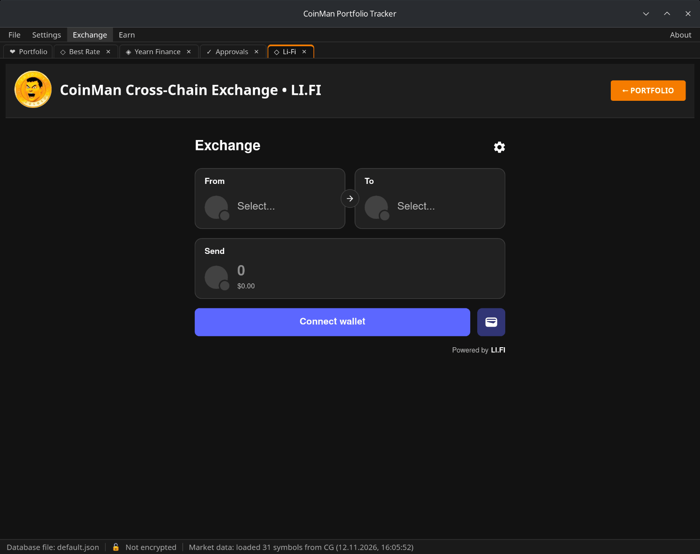
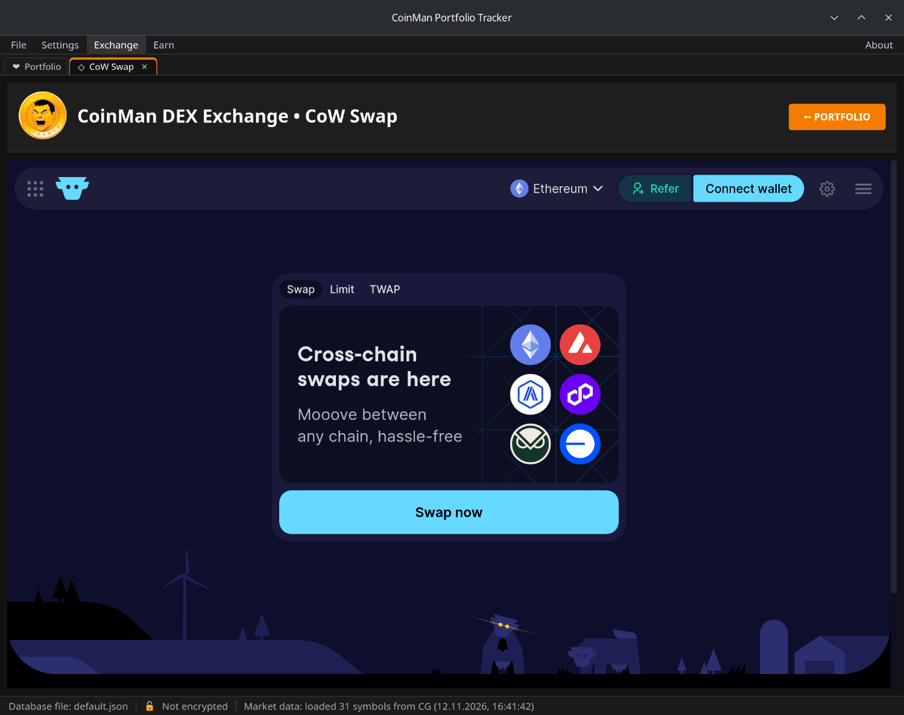
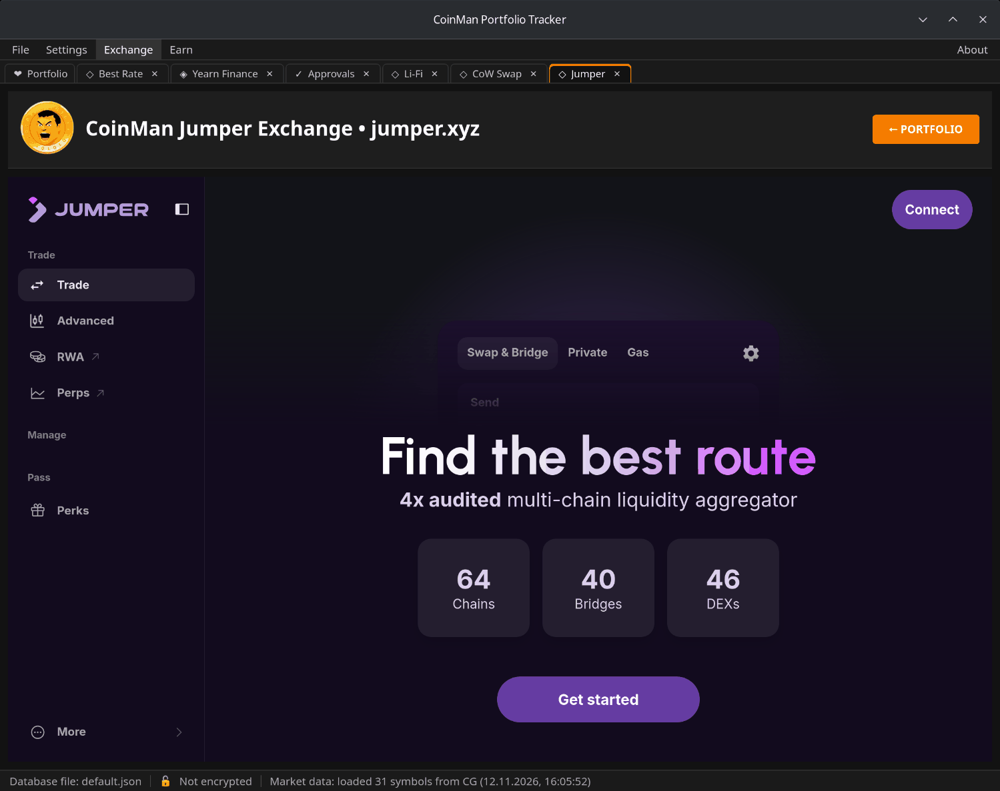

# Li-Fi, CoW Swap and Jumper

Three exchanges are built in as they are. They use the wallet selected in
[Wallets](08-wallets.md); each opens in its own [tab](07-window-tabs.md).

## Li-Fi

**Exchange → Li-Fi** — the LI.FI widget: swaps and bridges between networks,
including Tron. Choose **From** and **To**, type the amount and connect the
wallet. LI.FI transactions are checked before they are sent to the wallet.

## CoW Swap

**Exchange → CoW Swap** — the CoW Swap trading widget with an orders panel.
Orders are signed in the wallet and filled by CoW Protocol solvers. CoW Swap
routes in Best Rate open this tab with the pair and the amount filled in.

On Linux and macOS the tab shows the full swap.cow.fi site instead of the
widget (the site cannot be embedded there). To connect, click **Connect
wallet** on the site and choose **CoinMan wallet** — the wallet selected in
CoinMan. Requests go to your wallet only from the connected account and on its
network.

## Jumper Exchange

**Exchange → Jumper Exchange** opens [jumper.xyz](https://jumper.xyz) inside
the program with the selected CoinMan wallet. Every request from the site to
the wallet goes through CoinMan's safety check: unknown contracts, unlimited
approvals and other risky requests are refused or reduced to the swap amount.
Links from the site to other addresses open in the browser.

Jumper routes in Best Rate open this tab at the right address.
