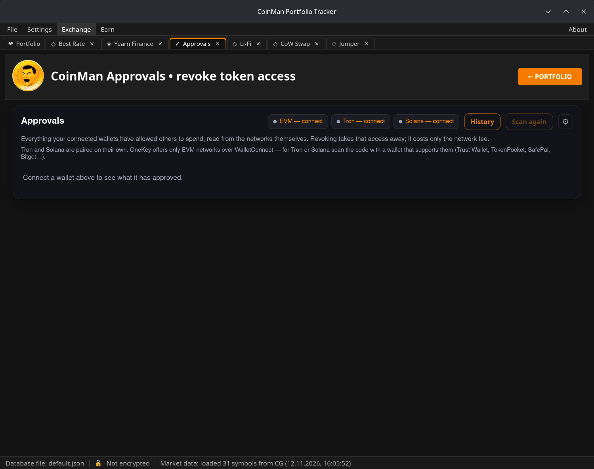

# Approvals

When you swap a token or deposit it somewhere, you allow a contract to spend
it — this is an approval. Approvals remain after the swap, and an unlimited
one lets the contract take all the tokens of this kind at any time.
**Exchange → Approvals** finds them and revokes the ones you no longer need.

Networks: 16 EVM networks, Tron and Solana.

## Connecting

The buttons at the top connect each kind of network: **EVM — connect**,
**Tron — connect**, **Solana — connect**. Tron and Solana are paired on their
own through WalletConnect. OneKey offers only EVM networks over
WalletConnect — for Tron or Solana scan the code with a wallet that supports
them (Trust Wallet, TokenPocket, SafePal, Bitget…).

A saved wallet that is not connected is scanned too, to view only; to revoke,
reconnect it (see [Wallets](08-wallets.md)).

## The list

Approvals are grouped by network. For each one:

- **Asset** — the token;
- **Approved to** — the contract that may spend it;
- **Allowance** — how much it may spend (unlimited or an amount);
- **Exposed** — how much of your balance this puts at risk;
- **Set on** — when the approval was given;
- **Risk** — the program's assessment; risky approvals are listed first.

**Only risky** hides the rest; the network list shows one network or all.
**Scan again** repeats the scan. Networks that could not be checked are
listed with the reason.

## Revoking

Tick the approvals and click **Revoke selected**, or click the button in a
row. The program checks each revoke against the live networks, shows what
will be sent, and then asks the wallet to sign. A revoke sets the approval to
zero; it never sends coins or tokens and costs only the network fee.

**History** lists your revokes; it is stored in `data/revoke-history.json`.

## Settings

**⚙** opens the settings:

- **HyperSync API key** — free at
  [envio.dev/app/api-tokens](https://envio.dev/app/api-tokens). It is needed
  to read approvals on BNB Chain, Linea, Mantle and Blast and makes the scan
  faster everywhere. The key is stored only in this computer's settings;
  press **Scan again** after entering it.
- **EVM networks to scan** — untick networks you do not use.
