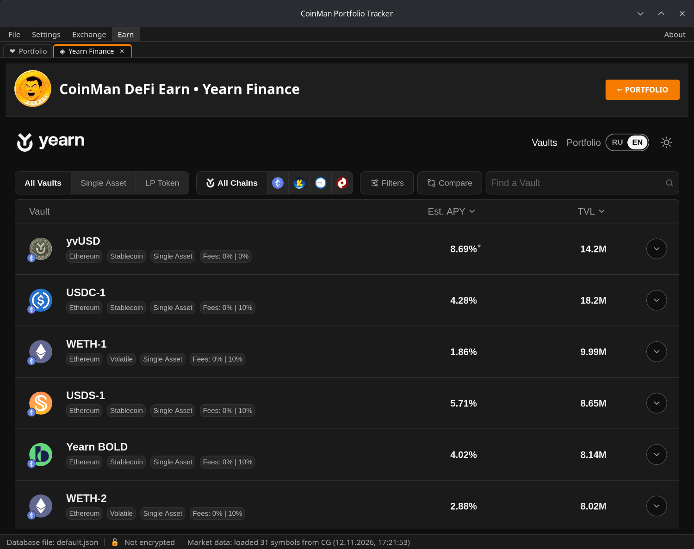
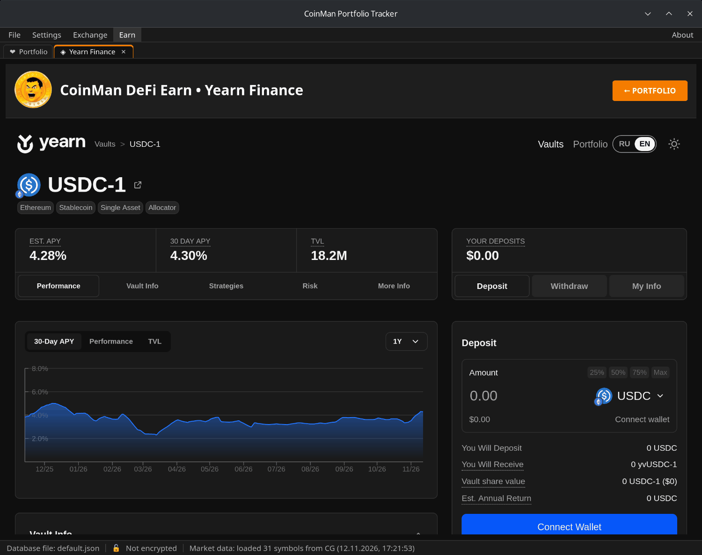

# Earn — Yearn Finance

**Earn → Yearn Finance** opens Yearn vaults: you deposit a token, the vault
puts it to work in its strategies, and the deposit grows by the vault's
yield.

## Vaults

- **All Vaults / Single Asset / LP Token** — the kind of vault.
- **All Chains** and the network icons — filter by network.
- **Filters** — category, risk, minimum TVL, retired vaults.
- **Compare** — choose several vaults and compare them side by side.
- **Find a Vault** — search by name or token.
- Sort by **Est. APY** (expected yield) or **TVL** (how much is deposited).

Click a vault to open its page: the expected and 30-day APY, TVL, and the
**Performance**, **Vault Info**, **Strategies**, **Risk** and **More Info**
sections — APY and TVL charts, strategies and their allocation, fees, risk
information and the vault's contracts.

## Deposit and withdraw

On the right of the vault page choose **Deposit** or **Withdraw**, the token
and the amount (or 25%, 50%, 75%, Max), and confirm in the wallet. **My Info**
shows your position in this vault. When a vault is closed for deposits,
withdrawals stay available. The actions fit each vault type:

- yvUSD — unlocked and locked positions;
- yBOLD — staking;
- Enso token zaps — deposit from a different token where supported;
- migration of eligible retired vaults to their successors.

## Portfolio

**Portfolio** shows your positions in the selected wallet: holdings,
allocation, history and activity.

The **RU / EN** switch changes the module's language.

The wallet is connected through the program's own **Earn → Wallet Connect**
menu (see [Wallets](08-wallets.md)), not on the Yearn page.
