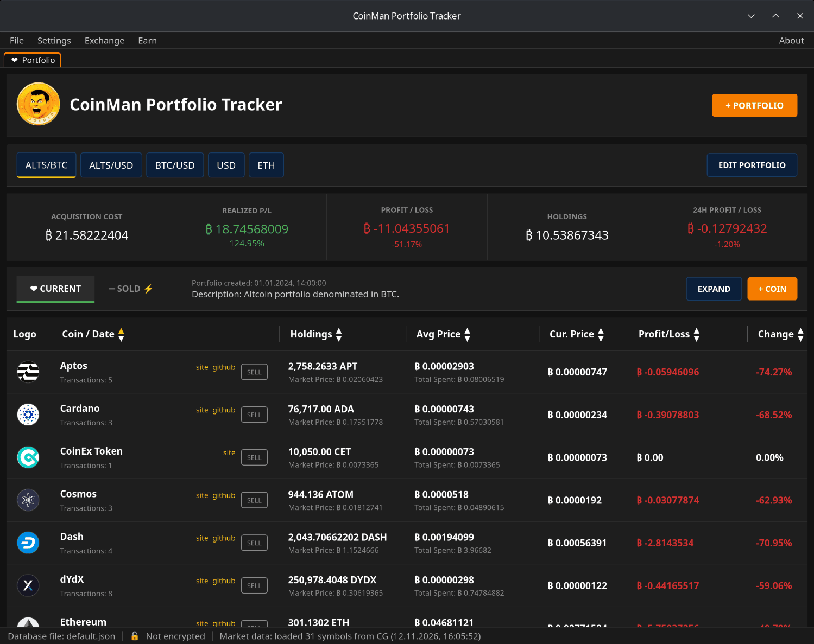

# Что такое CoinMan

CoinMan Portfolio Tracker — программа для компьютера, в которой ведётся учёт
покупок и продаж криптовалюты и видно, сколько всё это стоит сейчас. В неё
также встроены обменники (обмен и перевод между сетями), менеджер разрешений
на токены и хранилища Yearn Finance.

## Коротко

- **Портфели.** Сколько угодно портфелей в одном файле базы, у каждого своя
  валюта: USD, BTC, ETH и так далее. По каждой монете: количество, средняя
  цена покупки, текущая цена, прибыль или убыток и изменение в процентах.
- **Покупки и продажи.** Каждая покупка — сделка с ценой, количеством,
  датой, кошельком и заметками. Продажа списывает монеты начиная с самых
  старых покупок и переносит их во вкладку **Sold** с зафиксированной
  прибылью.
- **Цены** берутся из CoinGecko (ключ не нужен) или CoinMarketCap (свой
  API-ключ).
- **Хранение на компьютере.** Портфели лежат в JSON-файлах у вас на диске.
  Без регистрации, почты и телефона. Базу можно зашифровать паролем
  (AES-256-GCM, Argon2id).
- **Обмен.** Best Rate сравнивает 15 сервисов и находит лучший маршрут;
  Li-Fi, CoW Swap и Jumper встроены как полноценные обменники.
- **Approvals** показывает, какие контракты могут тратить ваши токены, и
  отзывает разрешения.
- **Earn** — хранилища Yearn Finance: просмотр, сравнение, депозит и вывод.
- **Вкладки окна** держат открытыми несколько модулей сразу.

## Что уходит в интернет

Сам портфель работает без интернета. В сеть программа обращается за:

- ценами (CoinGecko или CoinMarketCap);
- проверкой обновлений (GitHub, раз в неделю);
- обменом, Approvals и Earn: сервисы маршрутов, узлы блокчейнов, серверы
  WalletConnect, Yearn и сайты самих обменников.

Эти сервисы видят адреса ваших кошельков и то, что вы у них запрашиваете;
транзакции в блокчейнах публичны. Ключи не покидают кошелёк: CoinMan просит
кошелёк подписать и перед этим проверяет каждую транзакцию.

## Чего программа не делает

- Не хранит ваши монеты и ключи и не может перевести монеты без вашего
  подтверждения в кошельке.
- Не подтягивает в портфель балансы с бирж и кошельков: сделки в портфеле
  вводятся вручную.
- Не даёт финансовых советов. Проверяйте суммы, адреса и комиссии перед
  подписью.

## Лицензия

CoinMan Portfolio Tracker — открытая программа под лицензией MIT.
Исходный код: [github.com/coinman-dev/portfolio](https://github.com/coinman-dev/portfolio).
