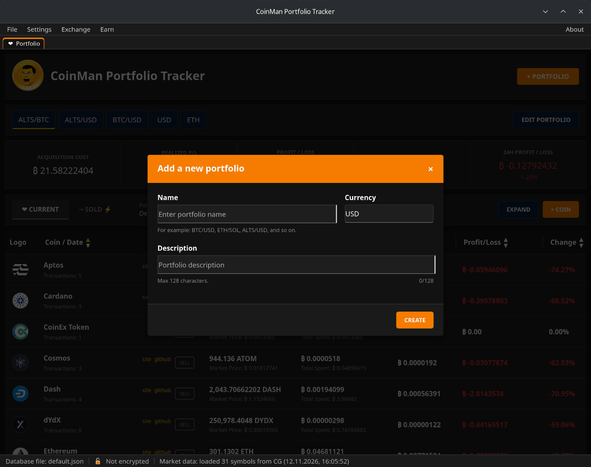
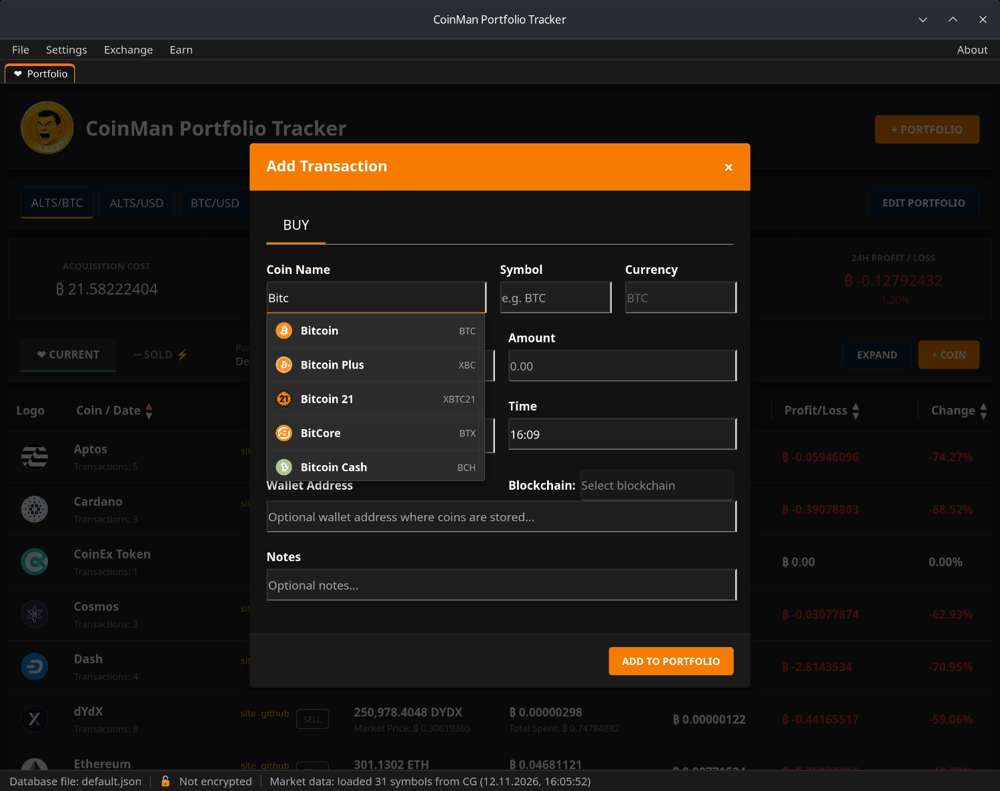

# Быстрый старт

## 1. Запустите программу

При первом запуске программа создаёт рядом с собой базу
`data/base/default.json` с одним портфелем и открывает главное окно. Имя
открытой базы видно слева в строке состояния.

## 2. Создайте портфель

Нажмите **+ PORTFOLIO**.

- **Name** — любое название, например `ALTS/BTC` или `Долгосрок`.
- **Currency** — в чём считается портфель: `USD`, `BTC`, `ETH` и так далее.
  Цены, затраты и прибыль показываются в этой валюте.
- **Description** — описание, необязательно, до 128 символов.

Нажмите **CREATE**. Новый портфель появится кнопкой под заголовком; нажатие
на кнопку переключает на этот портфель.

## 3. Добавьте покупку

Нажмите **+ COIN**.

1. Начните вводить название монеты в **Coin Name** и выберите её из списка —
   символ и логотип подставятся из каталога.
2. **Buy Price** — цена одной монеты в валюте портфеля.
3. **Amount** — сколько монет куплено.
4. **Date** и **Time** — когда куплено.
5. По желанию: адрес кошелька и блокчейн, где лежат монеты, и заметки.

Нажмите **ADD TO PORTFOLIO**. Монета появится в таблице с текущей ценой и
прибылью.

## 4. Что дальше

- [Портфели и сделки](04-portfolios-and-transactions.md) — продажа,
  исправление, вкладка Sold и что означают цифры.
- [Файлы баз и шифрование](05-databases-and-encryption.md) — защитите базу
  паролем.
- [Best Rate](09-best-rate.md) — где обменять монеты по лучшему курсу.
