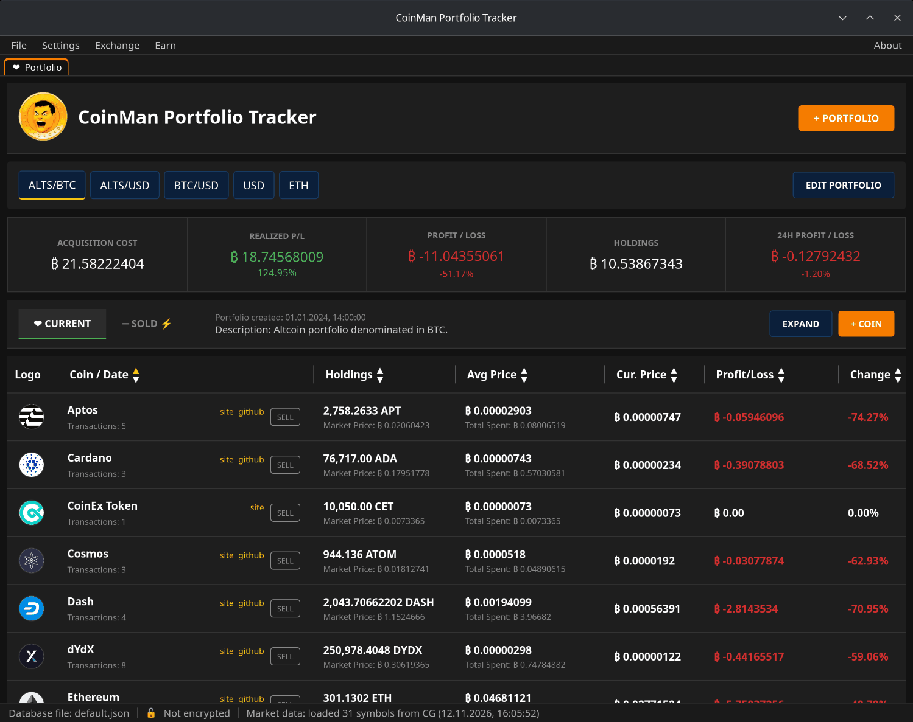
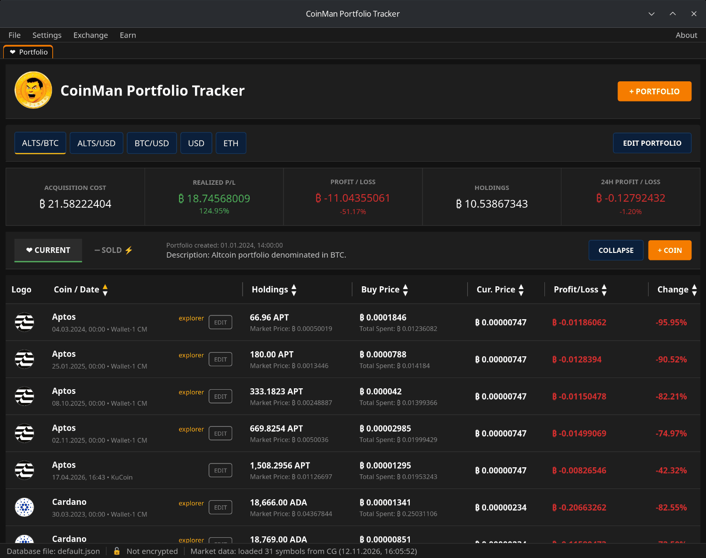
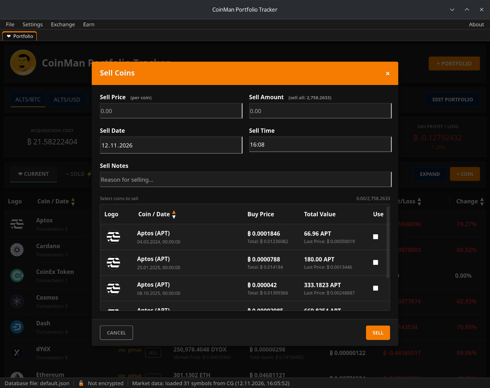
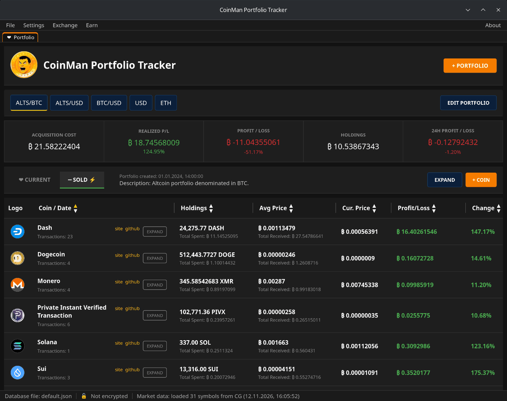
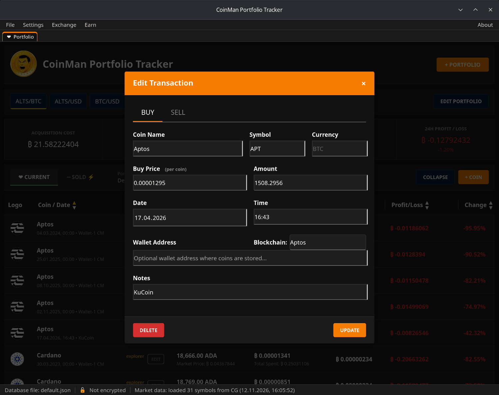
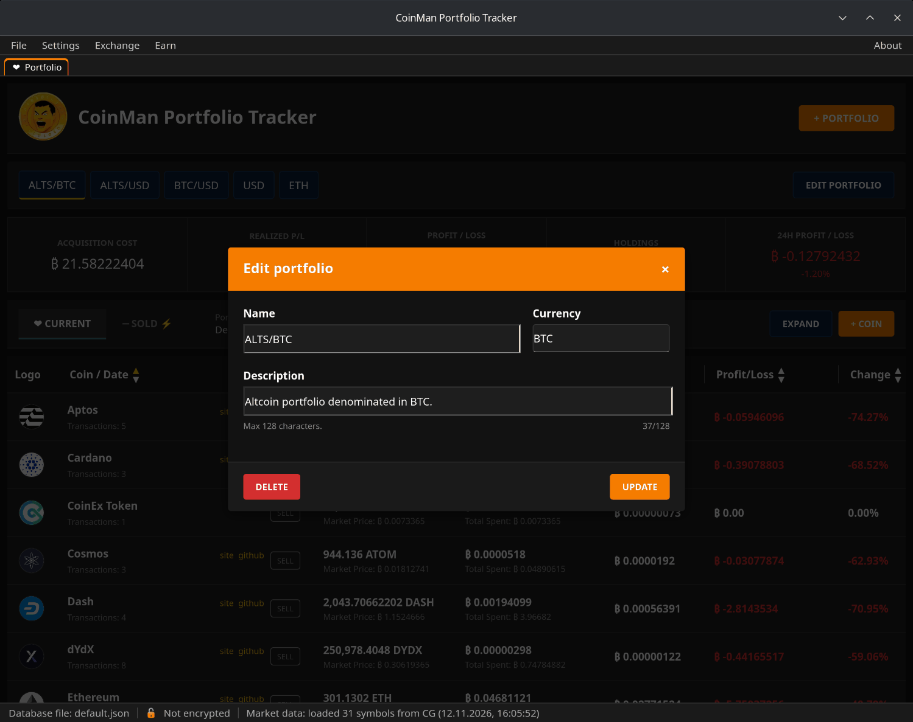

# Портфели и сделки

Сверху вниз:

- **Меню** — File, Settings, Exchange, Earn, About.
- **Вкладки окна** — Portfolio и открытые вами модули (см.
  [Вкладки окна](07-window-tabs.md)).
- **+ PORTFOLIO** — создать портфель.
- **Кнопки портфелей** (`ALTS/BTC`, `USD`…) — переключение между портфелями.
  Перетащите кнопку влево или вправо, чтобы поменять порядок. **EDIT
  PORTFOLIO** — переименовать, изменить описание или удалить портфель.
- **Цифры** выбранного портфеля (см. ниже).
- **CURRENT / SOLD** — монеты, которые у вас есть, и проданные.
- **EXPAND / COLLAPSE** — одна строка на монету или одна строка на сделку.
- **+ COIN** — добавить покупку.
- **Таблица** и внизу **строка состояния**.

## Цифры

| Показатель | Что это |
|---|---|
| Acquisition cost | Сколько стоили монеты, которые у вас есть: сумма «количество × цена покупки». |
| Realized P/L | Прибыль от продаж: сумма «(цена продажи − цена покупки) × количество» по вкладке Sold; ниже — в процентах от стоимости проданных монет. |
| Profit / Loss | Нереализованная прибыль: стоимость монет по текущей цене минус затраты, и в процентах. |
| Holdings | Сколько стоят ваши монеты по текущим ценам. |
| 24h Profit / Loss | Насколько изменилась их стоимость за последние 24 часа. |

Всё — в валюте портфеля. Монета без текущей цены считается по цене покупки.

## Таблица

В свёрнутом виде (так по умолчанию) каждая монета занимает одну строку:

- **Coin / Date** — монета, число сделок и ссылки на **site** и **github**
  проекта или на **explorer** с адресом кошелька.
- **Holdings** — общее количество и его рыночная стоимость.
- **Avg Price** — средняя цена покупки и сколько всего потрачено.
- **Cur. Price** — текущая цена (можно скрыть в настройках).
- **Profit/Loss** и **Change** — в валюте портфеля и в процентах.

Нажмите на заголовок столбца, чтобы отсортировать по нему; повторное
нажатие меняет порядок. Перетащите границу между заголовками, чтобы
изменить ширину столбца, — ширины запоминаются.

**EXPAND** показывает каждую покупку отдельной строкой с датой, кошельком,
заметками и кнопкой **EDIT**.

## Продажа

В свёрнутом виде нажмите **SELL** в строке монеты.

1. **Sell Price** — цена одной монеты в валюте портфеля.
2. **Sell Amount** — сколько монет продано. Подсказка показывает, сколько у
   вас есть («sell all»).
3. **Sell Date**, **Sell Time** и, по желанию, **Sell Notes**.

Список ниже показывает, из каких покупок списывается продажа: начиная с
самых старых (FIFO). Галочки следуют за введённым количеством. Если
количество покрывает покупку лишь частично, она делится: проданная часть
уходит во вкладку Sold, остаток остаётся в Current.

Нажмите **SELL**. Продать больше, чем есть, нельзя.

## Вкладка Sold

**SOLD** показывает проданные монеты: цены покупки и продажи, сколько всего
получено и зафиксированную прибыль. В свёрнутом виде кнопка в строке —
**EXPAND**: она раскрывает продажи по одной.

## Исправление и удаление сделки

Разверните таблицу и нажмите **EDIT** в строке сделки.

- Вкладка **BUY** меняет покупку: цену, количество, дату, кошелёк, заметки.
  **UPDATE** сохраняет, **DELETE** удаляет сделку.
- Вкладка **SELL** продаёт эту одну покупку (целиком или частично).

## Исправление и удаление портфеля

**EDIT PORTFOLIO** открывает название, валюту и описание выбранного
портфеля. **UPDATE** сохраняет; **DELETE** после подтверждения удаляет
портфель со всеми сделками. Последний оставшийся портфель удалить нельзя.

## Ввод чисел

В ценах и количествах дробную часть можно отделять и запятой, и точкой, а
группы цифр — пробелами: вставка `1 234,5` или `1,234.5` работает.
