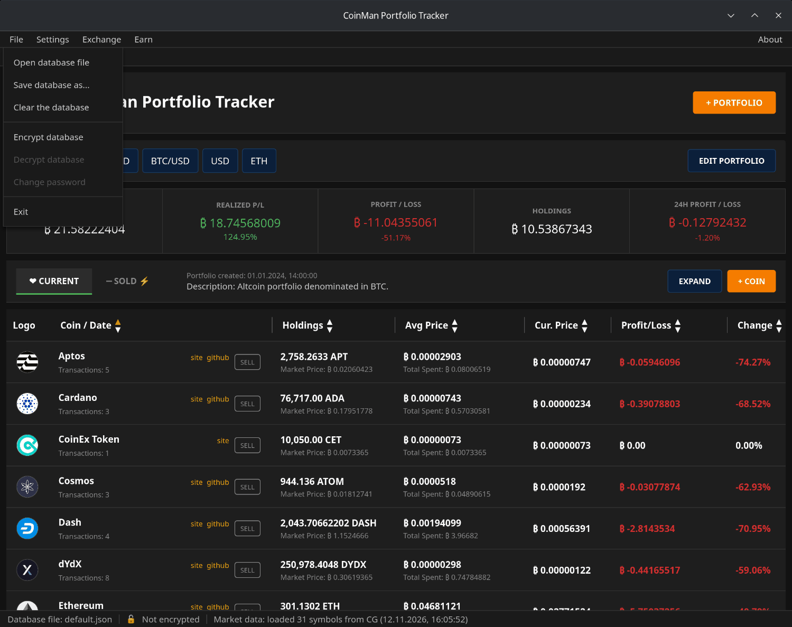
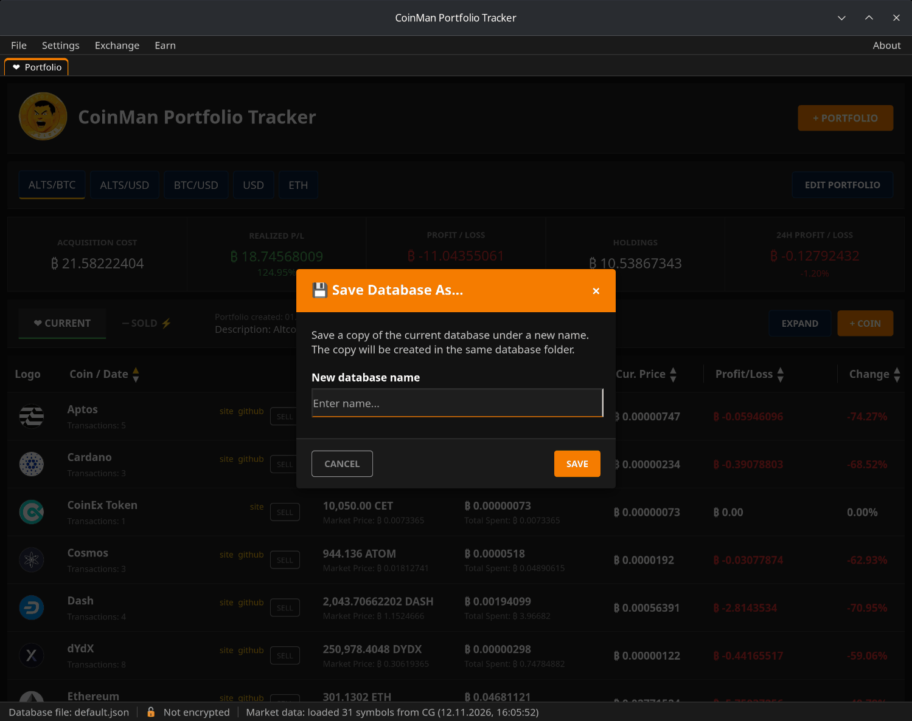
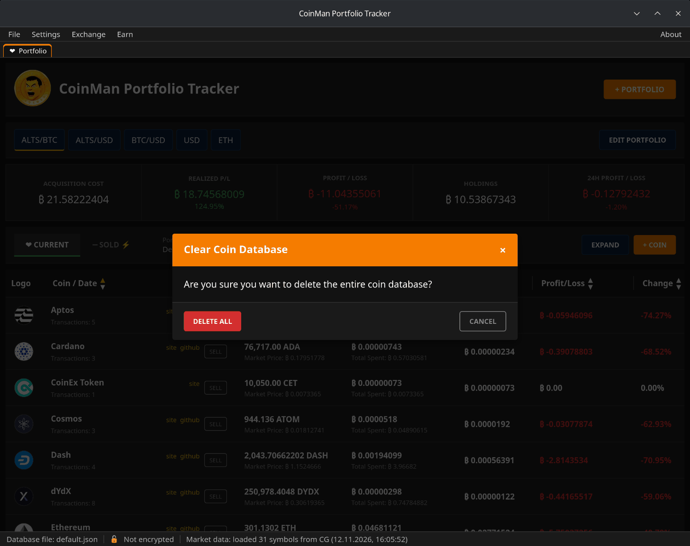
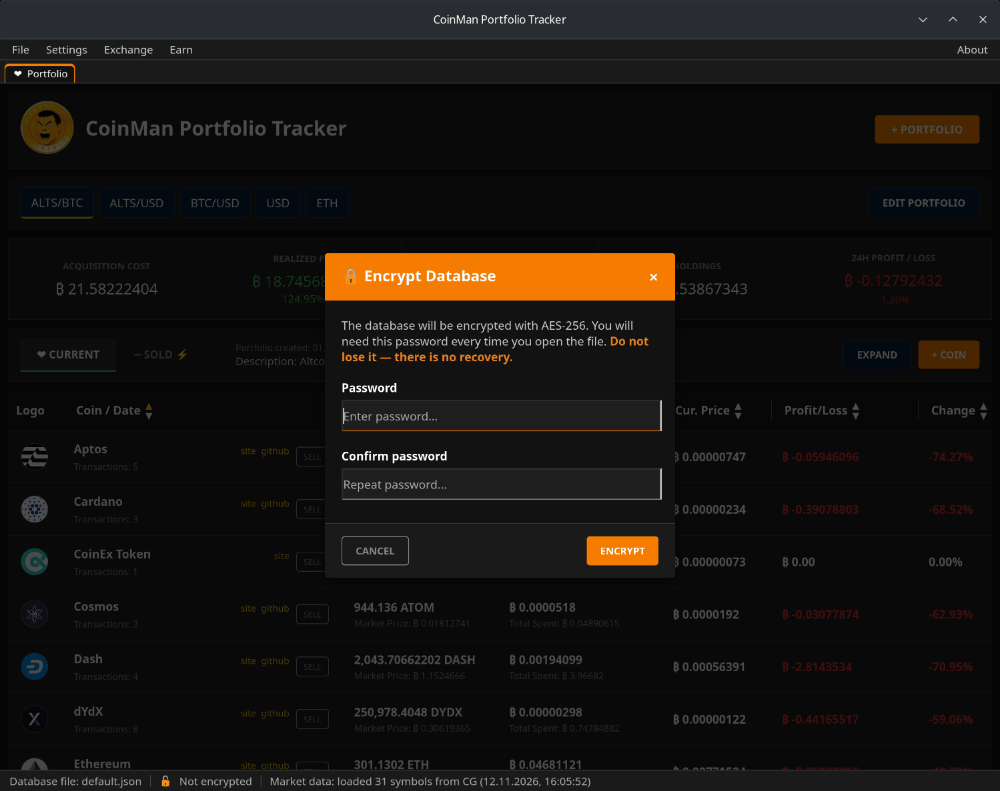
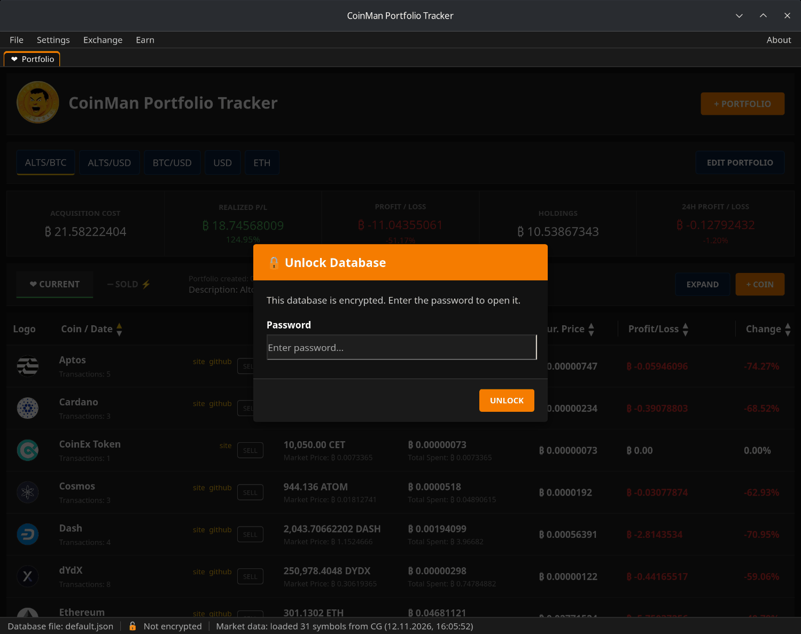

# Файлы баз и шифрование

Все портфели хранятся в базе — JSON-файле в папке `data/base` рядом с
программой. По умолчанию это `default.json`. Баз может быть несколько
(например, своя и семейная), между ними можно переключаться.

## Меню File

- **Open database file** — выбрать `.json`-файл в системном окне. Программа
  переключится на него; его имя появится в строке состояния.
- **Save database as...** — сохранить копию открытой базы под новым именем в
  той же папке.
- **Clear the database** — после подтверждения (**DELETE ALL**) удалить все
  монеты базы. Отменить нельзя, поэтому сначала сделайте копию.
- **Encrypt database / Decrypt database / Change password** — см. ниже.
- **Exit** — закрыть программу.

## Шифрование

**File → Encrypt database** защищает открытую базу паролем.

Введите пароль дважды и нажмите **ENCRYPT**. Файл остаётся на месте и под тем
же именем, но его содержимое зашифровано. В строке состояния вместо **Not
encrypted** появится **Encrypted**.

Когда программа открывает зашифрованную базу — при запуске или после **Open
database file**, — она спрашивает пароль:

- **Change password** — перешифровать базу новым паролем.
- **Decrypt database** — снять пароль и снова хранить базу обычным
  JSON-файлом.

Пароль нигде не сохраняется; программа держит его в памяти, только пока
работает.

> **Если забыть пароль, базу восстановить нельзя.** Храните пароль надёжно и
> держите резервную копию.

### Технические подробности

| | |
|---|---|
| Шифр | AES-256-GCM |
| Получение ключа | Argon2id, 64 МБ памяти, 2 прохода, 1 поток |
| Соль | 16 байт, новая при каждом шифровании |
| Nonce | 12 байт, новый при каждом шифровании |

### Что не шифруется

Шифруется только база портфелей. Настройки, API-ключи, сохранённые кошельки
и сеансы WalletConnect, истории обменов и отзывов и логи хранятся как есть —
см. [Файлы, папки и логи](13-files-and-logs.md). Не давайте посторонним
доступ к папке программы.
