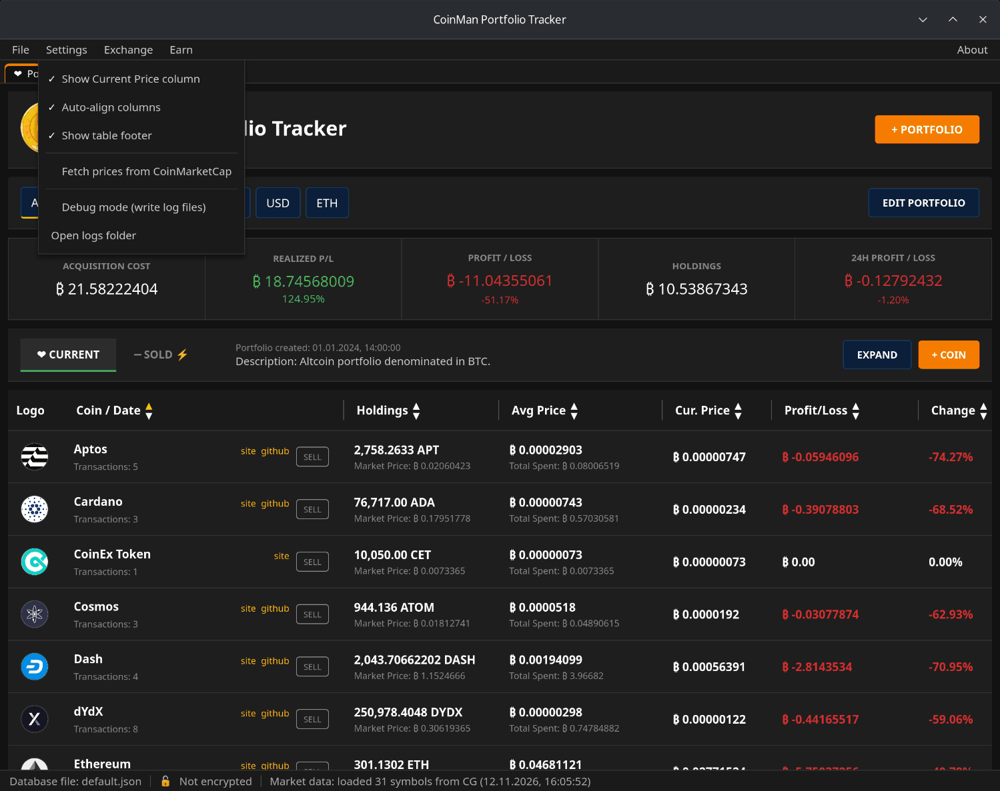
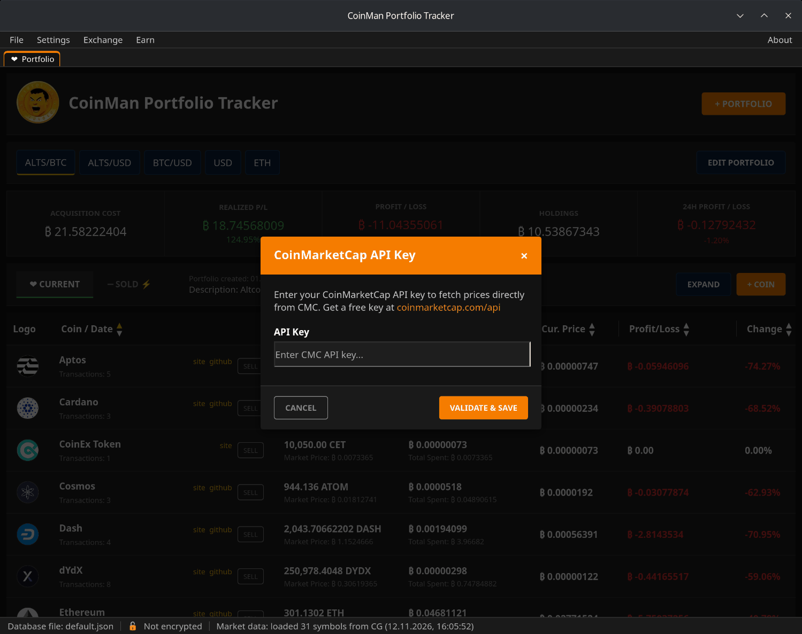
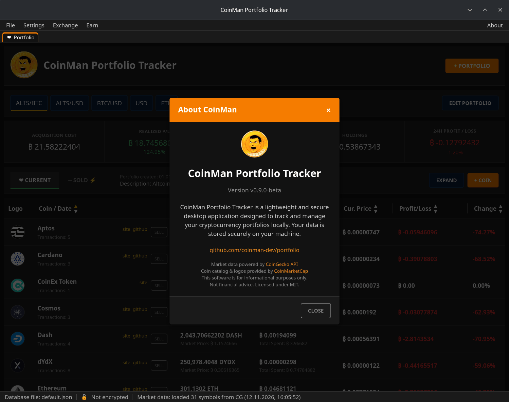

# Настройки и цены

Галочка перед пунктом — пункт включён. Изменения применяются сразу и
запоминаются.

| Пункт | Что делает |
|---|---|
| Show Current Price column | Показывает или скрывает столбец **Cur. Price**. |
| Auto-align columns | Подгоняет ширину столбцов под содержимое. Выключите, чтобы задавать ширину вручную, перетаскивая границы заголовков. |
| Show table footer | Строка итогов внизу таблицы. |
| Fetch prices from CoinMarketCap | Брать цены из CoinMarketCap вместо CoinGecko (см. ниже). |
| Debug mode (write log files) | Писать ежедневный лог в папку `Logs`. |
| Open logs folder | Открыть папку `Logs` в файловом менеджере. |

## Цены: CoinGecko или CoinMarketCap

По умолчанию цены берутся из **CoinGecko** — ключ не нужен.

Чтобы брать их из **CoinMarketCap**:

1. Получите бесплатный API-ключ на
   [coinmarketcap.com/api](https://coinmarketcap.com/api/).
2. Выберите **Settings → Fetch prices from CoinMarketCap**.
3. Вставьте ключ и нажмите **VALIDATE & SAVE**. Ключ сразу проверяется; если
   он работает, источником цен становится CoinMarketCap.

Если ключ перестанет работать, программа вернётся к CoinGecko. Чтобы
вернуться к CoinGecko самому, выберите тот же пункт меню ещё раз.

## Строка состояния

- **Database file** — имя открытой базы.
- **Encrypted / Not encrypted** — защищена ли она паролем.
- **Market data** — для скольких монет получена цена, из какого источника
  (`CG` — CoinGecko, `CMC` — CoinMarketCap) и когда.
- **Update available** — появляется, когда вышла новая версия; нажмите,
  чтобы открыть страницу релиза.

## О программе

**About → About CoinMan** показывает версию, ссылку на проект и источники
данных.

