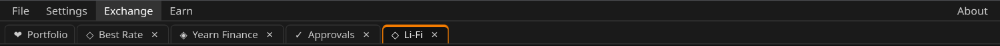

# Вкладки окна

Под меню — ряд вкладок, как в браузере.

- **Portfolio** есть всегда, закрыть её нельзя.
- Каждый модуль, открытый из меню **Exchange** или **Earn** — Best Rate,
  Li-Fi, CoW Swap, Jumper, Approvals, Yearn Finance, — получает свою
  вкладку. Если вкладка уже открыта, программа просто переключается на неё.
  Ссылки в Best Rate, открывающие CoW Swap или Jumper, тоже открывают их
  вкладки.
- Нажмите на вкладку, чтобы перейти на неё. Модули остаются загруженными в
  фоне, поэтому вкладка сохраняет состояние: расчёт Best Rate, открытое
  хранилище Yearn, страницу Jumper.
- **×** на вкладке или нажатие средней кнопкой мыши закрывает её. Закрытие
  только убирает вкладку; если снова открыть модуль, он будет таким, каким
  вы его оставили, — до перезапуска программы.
- Перетащите вкладку влево или вправо, чтобы поменять порядок.

Открытые вкладки и их порядок запоминаются между запусками. Восстановленная
вкладка загружает модуль, только когда вы впервые на неё нажмёте.

Кнопка **← PORTFOLIO** в заголовке модуля — то же, что вкладка Portfolio.
