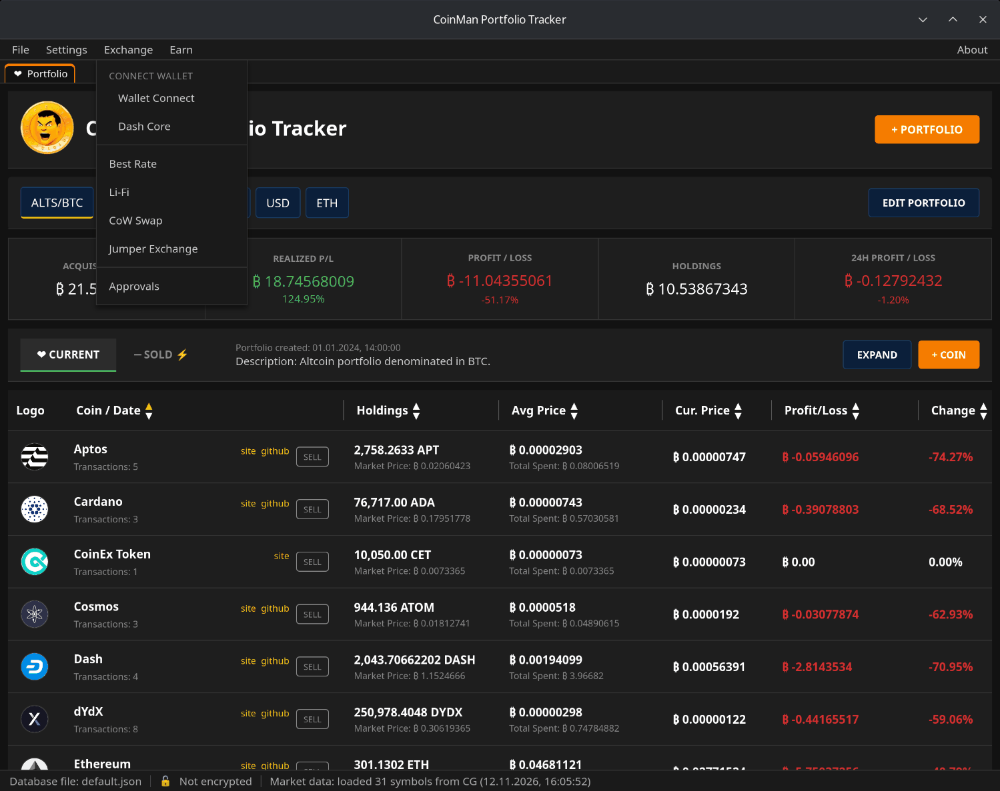
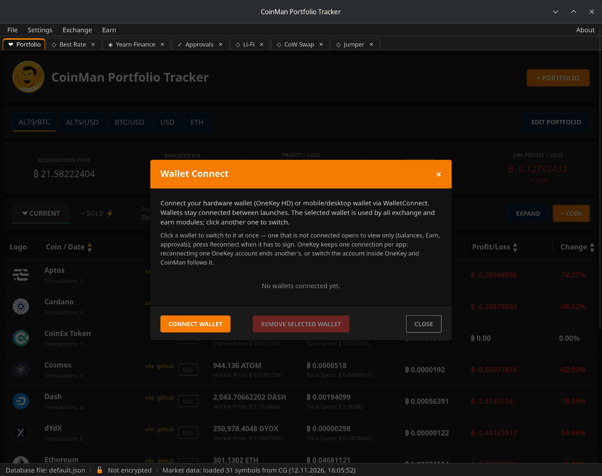
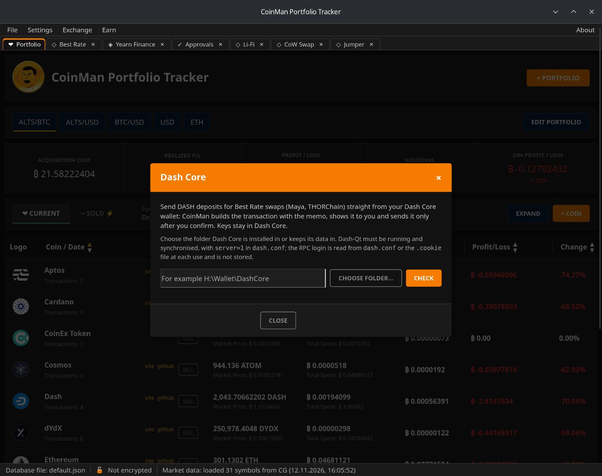

# Кошельки

Обмен, Approvals и Earn работают с вашим кошельком: показывают его балансы и
просят его подписать транзакции. Ключи остаются в кошельке; CoinMan только
отправляет ему запросы, а вы подтверждаете каждый в кошельке.

## WalletConnect

**Exchange → Wallet Connect** (или **Earn → Wallet Connect**) подключает
аппаратный кошелёк (OneKey) или мобильный и настольный кошелёк через
WalletConnect: отсканируйте QR-код кошельком и одобрите подключение.

- Сохранить можно несколько кошельков. **Выбранный** кошелёк используют все
  модули Exchange и Earn; чтобы переключиться, нажмите на другой в списке.
- Кошельки остаются подключёнными между запусками. Галочка в меню означает
  подключённый кошелёк.
- Сохранённый, но не подключённый кошелёк открывается **только для
  просмотра**: балансы, позиции в Earn и разрешения видны, но подписать он не
  может. Нажмите **Reconnect** в его строке, когда нужна подпись.
- **CONNECT ANOTHER WALLET** добавляет кошелёк, **REMOVE SELECTED WALLET**
  удаляет выбранный и завершает его сеанс WalletConnect и в приложении
  кошелька.

EVM-сети, Tron и Solana подключаются отдельно. OneKey держит одно
подключение на приложение: переподключение одного аккаунта OneKey
отключает другой — или переключите аккаунт внутри OneKey, и CoinMan
последует за ним.

Поддерживаемые EVM-сети: Ethereum, Arbitrum, Optimism, Polygon, BNB Chain,
Base, Avalanche, Katana, Gnosis, Linea, Sonic, Unichain, zkSync, Scroll,
Mantle и Blast. Отдельный обменник или хранилище может поддерживать меньше.

## Dash Core

**Exchange → Dash Core** подключает кошелёк Dash Core (Dash-Qt) на вашем
компьютере. Тогда Best Rate может отправлять депозиты DASH для обменов через
Maya Protocol и THORChain прямо из него — см.
[Best Rate → Отправка из Dash Core](09-best-rate.md#отправка-из-dash-core).

1. Запустите Dash-Qt и дождитесь синхронизации. В `dash.conf` должна быть
   строка `server=1`.
2. В CoinMan введите папку, куда установлен Dash Core или где он хранит
   данные, или выберите её кнопкой **CHOOSE FOLDER...**.
3. Нажмите **CHECK**. Программа проверит папку, `dash.conf`, логин RPC, что
   узел отвечает, синхронизирован и кошелёк открыт, и запомнит папку.

Логин RPC читается из `dash.conf` или файла `.cookie` при каждом обращении и
не сохраняется. Ключи остаются в Dash Core.
