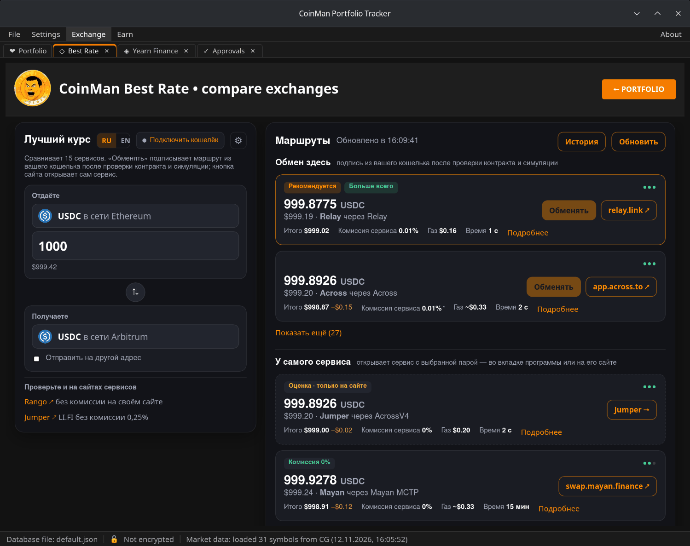
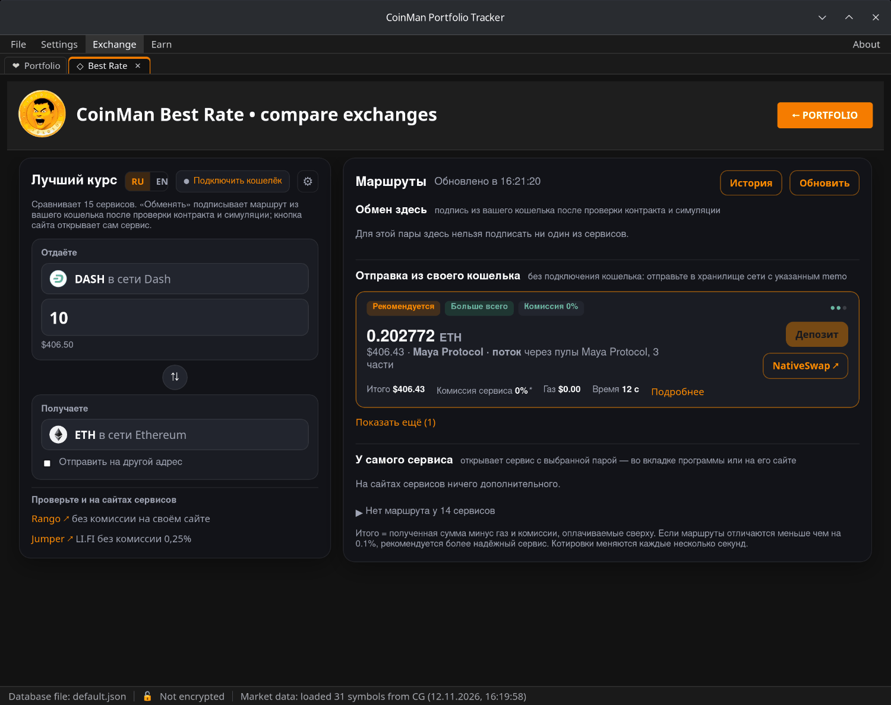
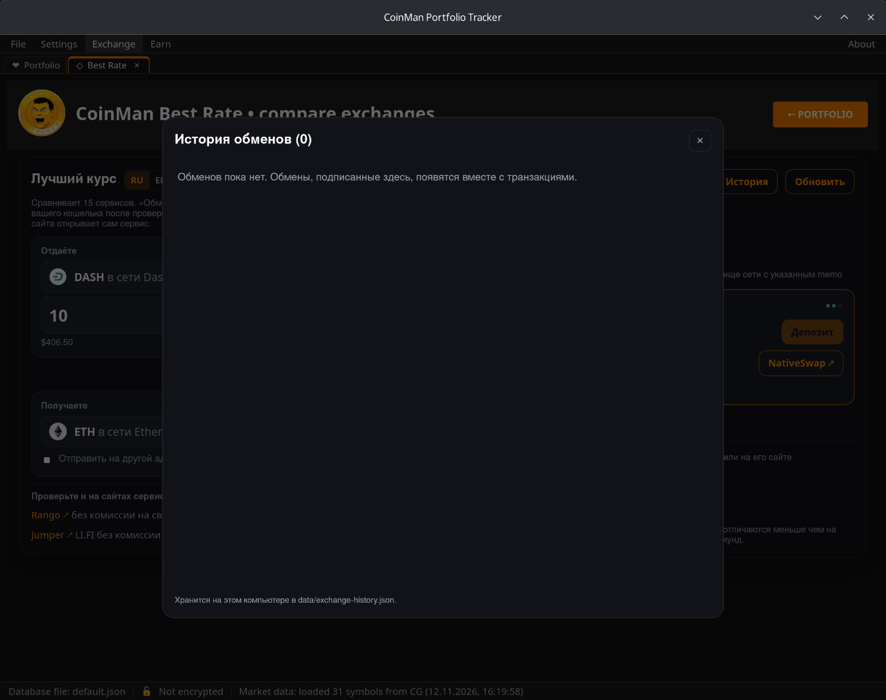
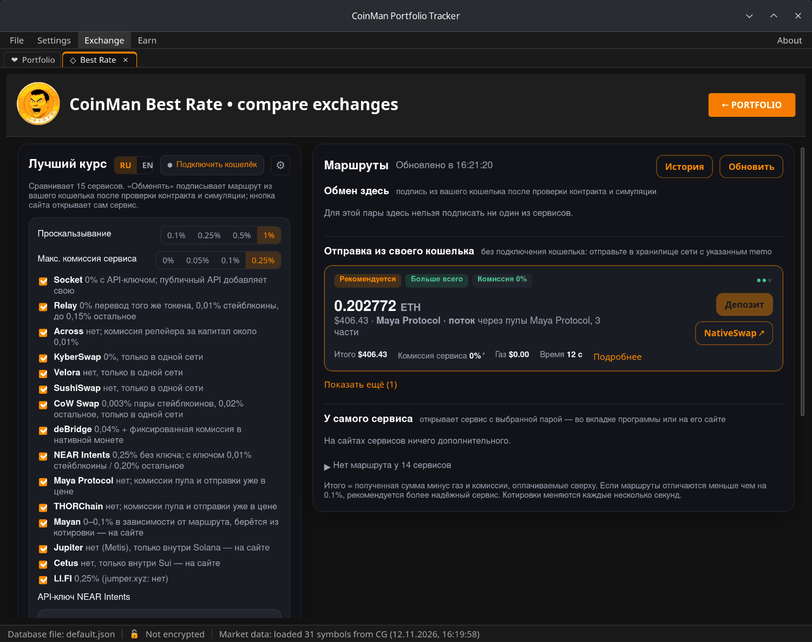

# Best Rate

**Exchange → Best Rate** («Лучший курс») одновременно спрашивает 15 сервисов
обмена и переводов между сетями и показывает их предложения рядом, лучшие
сверху.

Сервисы: LI.FI, Bungee/Socket, Relay, KyberSwap, CoW Protocol, deBridge,
NEAR Intents, Maya Protocol, THORChain, Across, SushiSwap, Velora, Jupiter,
Cetus и Mayan, а также ссылка на LlamaSwap для обменов внутри одной
EVM-сети.

Сети и монеты: EVM-сети, Solana, Tron и Sui, а также нативные BTC, DASH,
ZEC, LTC, DOGE, BCH и XRP.

Переключатель **RU / EN** вверху меняет язык модуля.

## Получение котировок

1. **Отдаёте** — выберите монету и сеть и введите количество.
2. **Получаете** — выберите монету и сеть, которые хотите получить. Кнопка
   **⇅** меняет их местами.
3. Котировки появляются справа и обновляются каждые несколько секунд;
   **Обновить** запрашивает их сразу.

Без подключённого кошелька котировки считаются для подставного адреса —
цены настоящие, но для обмена нужен кошелёк (или, для монет, отправляемых
вручную, адрес получения).

**Отправить на другой адрес** — монеты придут на введённый адрес, а не в ваш
кошелёк.

## Как читать маршрут

В карточке маршрута:

- сколько вы получите и сколько это в долларах;
- сервис и путь (например, «Maya Protocol · поток через пулы Maya Protocol,
  3 части»);
- **Итого** — полученная сумма минус газ и комиссии, оплачиваемые сверху;
- **Комиссия сервиса**, **Газ** и **Время**;
- метки: **Рекомендуется**, **Больше всего**, **Комиссия 0%**, **Оценка ·
  только на сайте** и другие; **Мало ликвидности** предупреждает, что пул
  мал для этой суммы, и называет пул и долю обмена в нём;
- **Подробнее** — полная раскладка.

Когда маршруты отличаются меньше чем на 0,1%, рекомендуется более надёжный
сервис.

Маршруты разделены на группы:

- **Обмен здесь** — маршрут подписывается из вашего кошелька в CoinMan после
  проверки контракта и симуляции транзакции. Кнопка **Обменять**.
- **Отправка из своего кошелька** — для монет без подключения кошелька (BTC,
  DASH, ZEC, LTC, DOGE, BCH, XRP): вы отправляете их в хранилище сети с
  указанным memo. Кнопка **Депозит** — см. ниже.
- **У самого сервиса** — сервис открывается с заполненной парой: во вкладке
  CoinMan (CoW Swap, Jumper — отмечены →) или на его сайте в браузере
  (отмечены ↗).
- **Нет маршрута у N сервисов** — нажмите, чтобы увидеть, у каких сервисов
  нет ничего для этой пары и почему.

## Обмен в программе

**Обменять** готовит транзакцию, проверяет её (контракт, получателя, токены
и суммы по котировке) и симулирует, затем отправляет в кошелёк на подпись.
Если нужно разрешение на токен, программа просит ровно обмениваемую сумму, а
не безлимитное. Подтвердите в кошельке.

Обмены через Maya Protocol и THORChain из ETH, Arbitrum, Base, Avalanche и
BSC тоже подписываются здесь; пока сеть отправки или выплаты остановлена,
они не отправляются.

## Депозиты из BTC, DASH и других монет

Для монет, которые нельзя подключить как кошелёк, **Депозит** открывает
панель депозита. Сначала введите **адрес получения** — без него кнопка
неактивна.

Панель берёт свежую котировку, проверяет хранилище сети и memo и
показывает:

- адрес хранилища, сумму и memo;
- команды для консоли кошелька Core;
- текст для поля «Pay to» в Electrum (Electrum, Electrum-LTC, Dash
  Electrum).

Важно:

- Если обмен не состоится, монеты вернутся на адрес **первого входа** вашей
  транзакции. В Electrum выберите адрес оплаты на вкладке Coins.
- Входы с мультиподписью Maya и THORChain не принимают.

После отправки введите идентификатор транзакции (txid) и нажмите
**Отправил — следить за обменом**: депозит появится в истории, и программа
будет следить за ним там.

### Отправка из Dash Core

Если Dash Core подключён ([Кошельки → Dash Core](08-wallets.md#dash-core)),
панель депозита DASH предлагает **Отправить из Dash Core**. CoinMan
собирает транзакцию (хранилище, memo и сдача на тот же адрес; залог
мастерноды никогда не тратится), показывает её, проверяет до и после
подписи и отправляет только после вашего подтверждения.

## История

**История** — обмены, подписанные в CoinMan, и депозиты, за которыми вы
следите, с их состоянием и ссылками на обозреватели. Хранится на вашем
компьютере в `data/exchange-history.json`.

## Настройки

Кнопка **⚙** открывает настройки:

- **Проскальзывание** — насколько может сдвинуться цена, прежде чем обмен
  отменится: 0,1%, 0,25%, 0,5% или 1%.
- **Макс. комиссия сервиса** — маршруты с более высокой комиссией уходят в
  отдельный список **Выше вашего лимита комиссии N%** под остальными.
- **Список сервисов** с их комиссиями — снимите галочку, чтобы больше не
  спрашивать сервис.
- **API-ключ NEAR Intents** — ключ с partners.near-intents.org снижает его
  комиссию.

## Проверьте и на сайтах сервисов

Слева внизу — ссылки на сервисы, которые стоит проверить вручную, например
Rango и Jumper (LI.FI без комиссии 0,25%).
