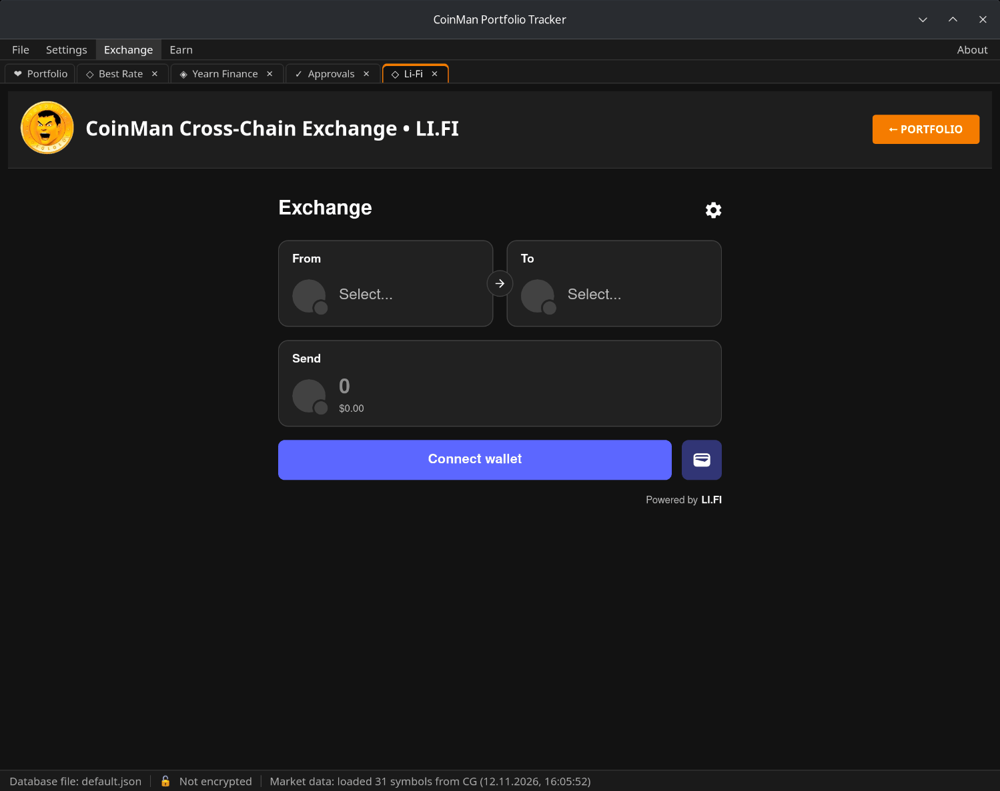
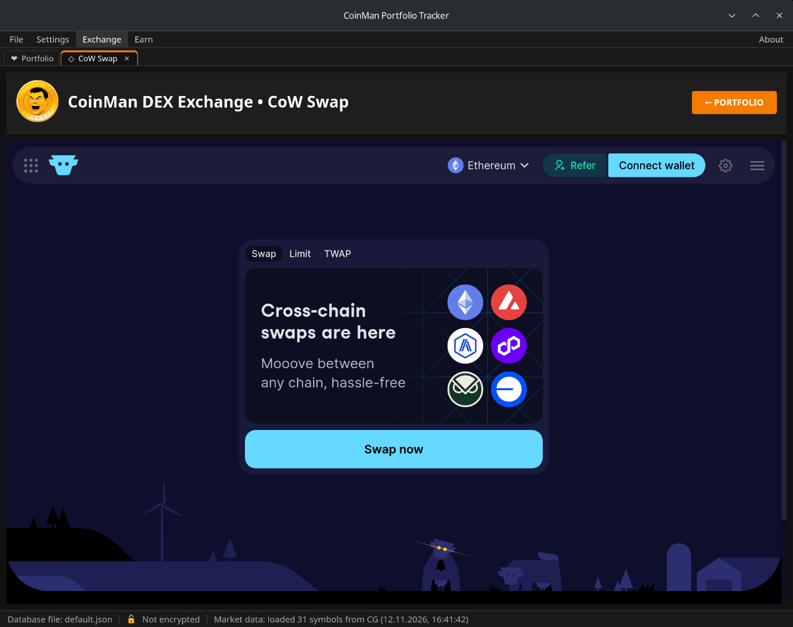
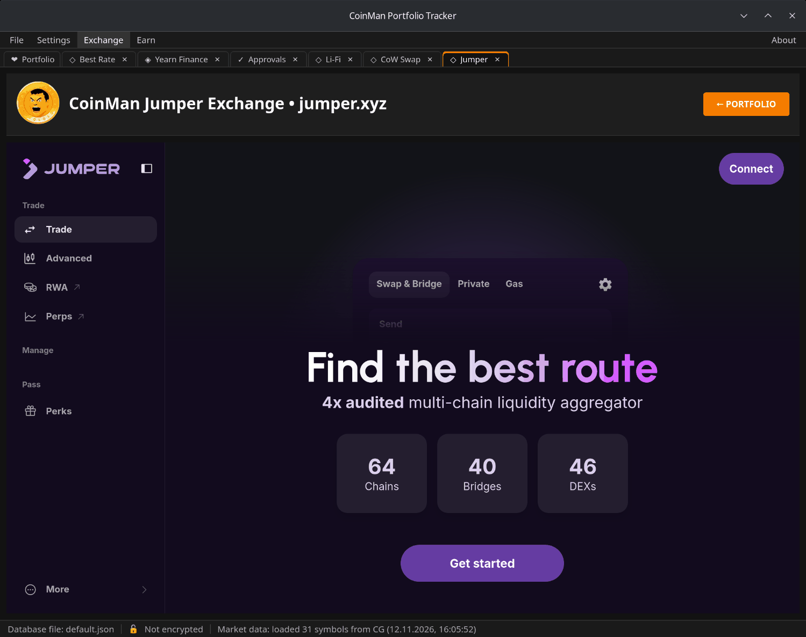

# Li-Fi, CoW Swap и Jumper

Три обменника встроены целиком. Они используют кошелёк, выбранный в разделе
[Кошельки](08-wallets.md); каждый открывается в своей
[вкладке](07-window-tabs.md).

## Li-Fi

**Exchange → Li-Fi** — виджет LI.FI: обмен и переводы между сетями, включая
Tron. Выберите **From** и **To**, введите количество и подключите кошелёк.
Транзакции LI.FI проверяются, прежде чем уйти в кошелёк.

## CoW Swap

**Exchange → CoW Swap** — торговый виджет CoW Swap с панелью ордеров.
Ордера подписываются в кошельке и исполняются солверами CoW Protocol.
Маршруты CoW Swap в Best Rate открывают эту вкладку с заполненной парой и
суммой.

В Linux и macOS во вкладке открывается полный сайт swap.cow.fi вместо
виджета (встроить его там нельзя). Чтобы подключиться, нажмите на сайте
**Connect wallet** и выберите **CoinMan wallet** — кошелёк, выбранный в
CoinMan. Запросы уходят в кошелёк только от подключённого аккаунта и в его
сети.

## Jumper Exchange

**Exchange → Jumper Exchange** открывает [jumper.xyz](https://jumper.xyz)
внутри программы с выбранным кошельком CoinMan. Каждый запрос сайта к
кошельку проходит проверку безопасности CoinMan: неизвестные контракты,
безлимитные разрешения и другие рискованные запросы отклоняются или
урезаются до суммы обмена. Ссылки с сайта на другие адреса открываются в
браузере.

Маршруты Jumper в Best Rate открывают эту вкладку на нужной странице.
