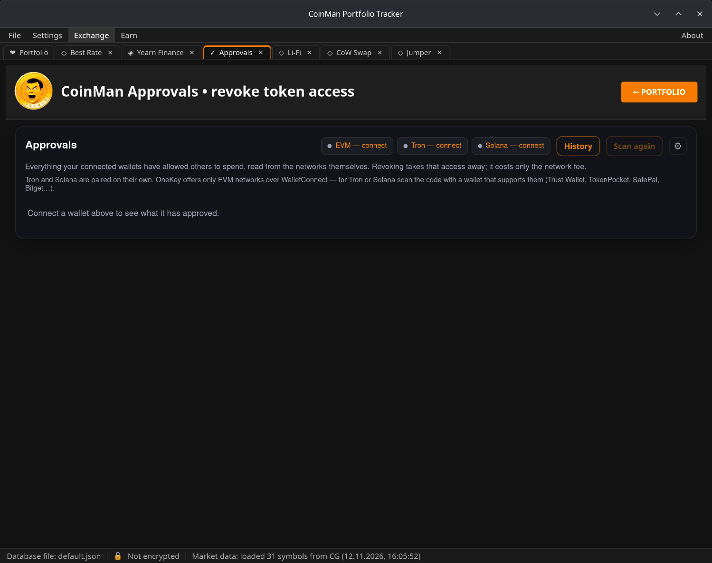

# Approvals

Когда вы обмениваете токен или куда-то его вносите, вы разрешаете контракту
его тратить — это разрешение (approval). Разрешения остаются и после обмена,
а безлимитное позволяет контракту в любой момент забрать все токены этого
вида. **Exchange → Approvals** находит их и отзывает ненужные.

Модуль пока только на английском.

Сети: 16 EVM-сетей, Tron и Solana.

## Подключение

Кнопки вверху подключают каждый вид сетей: **EVM — connect**, **Tron —
connect**, **Solana — connect**. Tron и Solana подключаются отдельно через
WalletConnect. OneKey через WalletConnect даёт только EVM-сети — для Tron или
Solana отсканируйте код кошельком, который их поддерживает (Trust Wallet,
TokenPocket, SafePal, Bitget…).

Сохранённый, но не подключённый кошелёк тоже проверяется — только для
просмотра; чтобы отозвать разрешения, переподключите его (см.
[Кошельки](08-wallets.md)).

## Список

Разрешения сгруппированы по сетям. Для каждого:

- **Asset** — токен;
- **Approved to** — контракт, которому разрешено тратить;
- **Allowance** — сколько он может потратить (без лимита или сумма);
- **Exposed** — какая часть вашего баланса под риском;
- **Set on** — когда разрешение выдано;
- **Risk** — оценка программы; рискованные разрешения показаны первыми.

**Only risky** скрывает остальные; список сетей показывает одну сеть или
все. **Scan again** повторяет проверку. Сети, которые не удалось проверить,
перечислены с причиной.

## Отзыв

Отметьте разрешения галочками и нажмите **Revoke selected** или нажмите
кнопку в строке. Программа сверяет каждый отзыв с живыми сетями, показывает,
что будет отправлено, и затем просит кошелёк подписать. Отзыв обнуляет
разрешение; он никогда не отправляет монеты или токены и стоит только
комиссию сети.

**History** — список ваших отзывов; хранится в `data/revoke-history.json`.

## Настройки

**⚙** открывает настройки:

- **HyperSync API key** — бесплатно на
  [envio.dev/app/api-tokens](https://envio.dev/app/api-tokens). Нужен, чтобы
  читать разрешения в BNB Chain, Linea, Mantle и Blast, и ускоряет проверку
  везде. Ключ хранится только в настройках этого компьютера; после ввода
  нажмите **Scan again**.
- **EVM networks to scan** — снимите галочки с сетей, которыми не
  пользуетесь.
