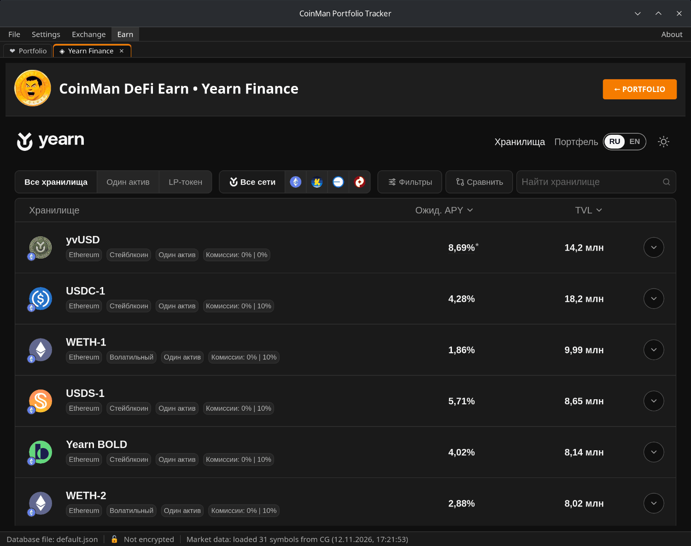
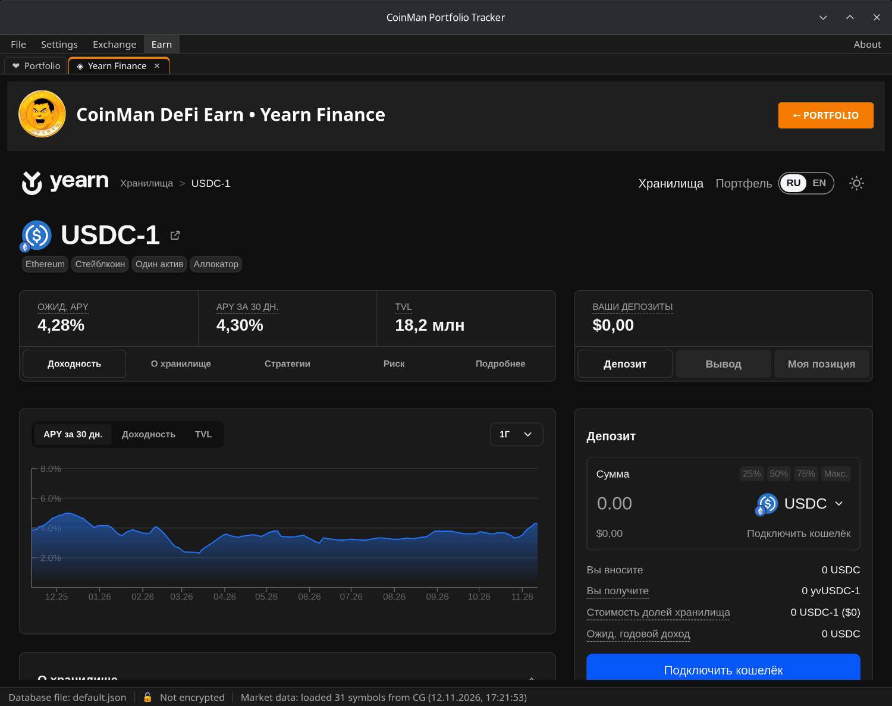

# Earn — Yearn Finance

**Earn → Yearn Finance** открывает хранилища Yearn: вы вносите токен,
хранилище пускает его в работу через свои стратегии, и депозит растёт на
доходность хранилища.

## Хранилища

- **Все хранилища / Один актив / LP-токен** — вид хранилища.
- **Все сети** и значки сетей — фильтр по сети.
- **Фильтры** — категория, риск, минимальный TVL, закрытые хранилища.
- **Сравнить** — выберите несколько хранилищ и сравните их рядом.
- **Найти хранилище** — поиск по названию или токену.
- Сортировка по **Ожид. APY** (ожидаемая доходность) или **TVL** (сколько
  внесено).

Нажмите на хранилище, чтобы открыть его страницу: ожидаемый APY и APY за
30 дней, TVL и разделы **Доходность**, **О хранилище**, **Стратегии**,
**Риск** и **Подробнее** — графики APY и TVL, стратегии и их доли,
комиссии, сведения о рисках и контракты хранилища.

## Депозит и вывод

Справа на странице хранилища выберите **Депозит** или **Вывод**, токен и
сумму (или 25%, 50%, 75%, Макс.) и подтвердите в кошельке. **Моя позиция**
показывает вашу позицию в этом хранилище. Если хранилище закрыто для депозитов, вывод
остаётся доступен. Действия зависят от вида хранилища:

- yvUSD — разблокированные и заблокированные позиции;
- yBOLD — стейкинг;
- зап токенов через Enso — депозит из другого токена, где это возможно;
- перенос из подходящих закрытых хранилищ в их преемников.

## Портфель

**Портфель** показывает ваши позиции в выбранном кошельке: что есть,
распределение, историю и операции.

Переключатель **RU / EN** меняет язык модуля.

Кошелёк подключается через меню самой программы **Earn → Wallet Connect**
(см. [Кошельки](08-wallets.md)), а не на странице Yearn.
